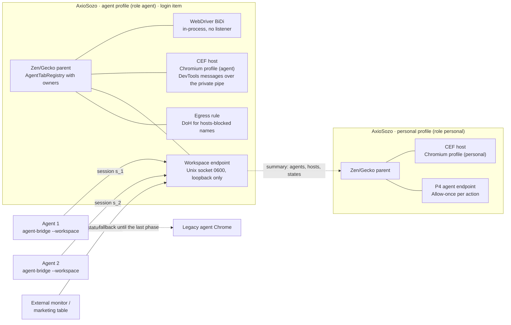
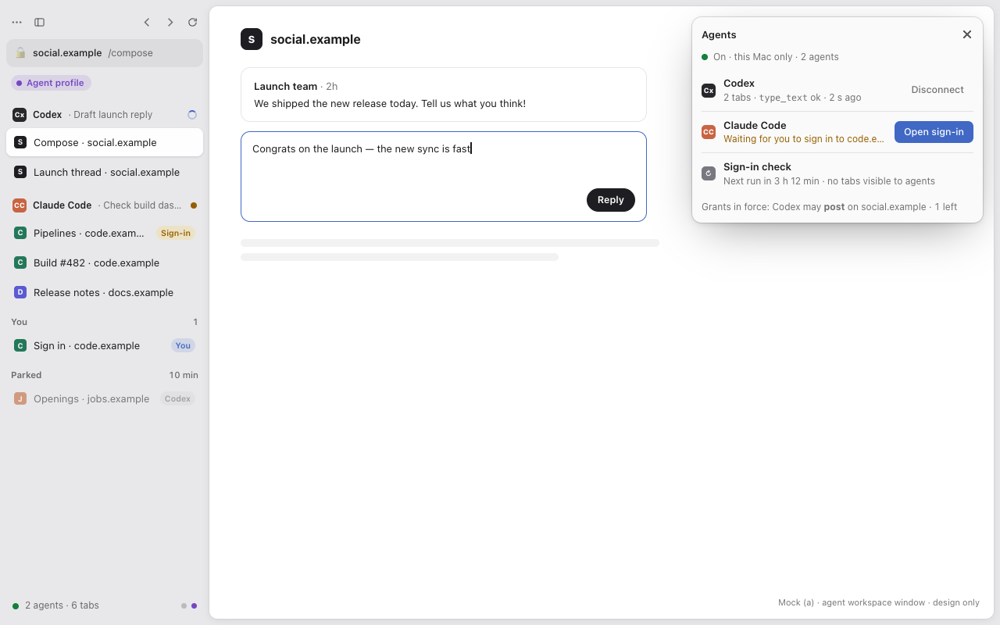
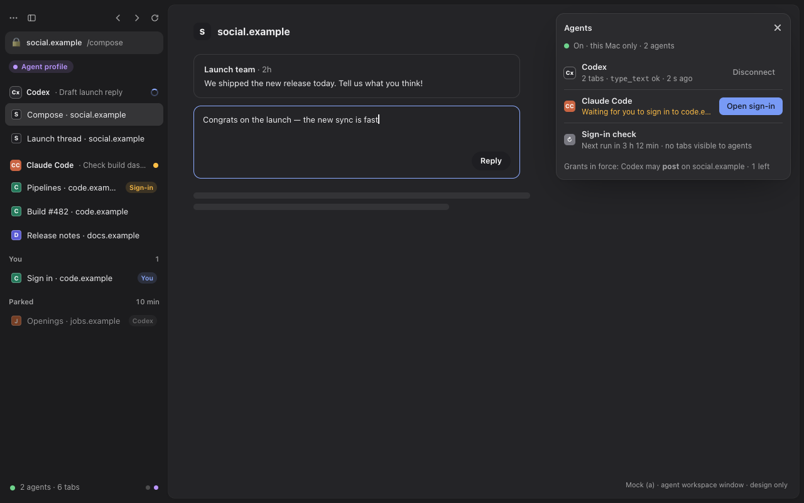
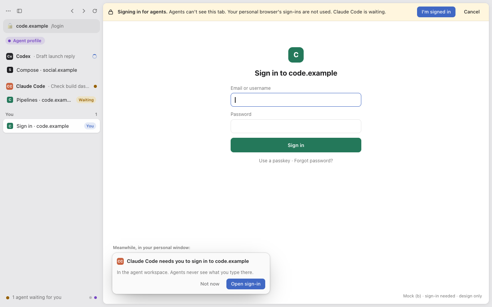
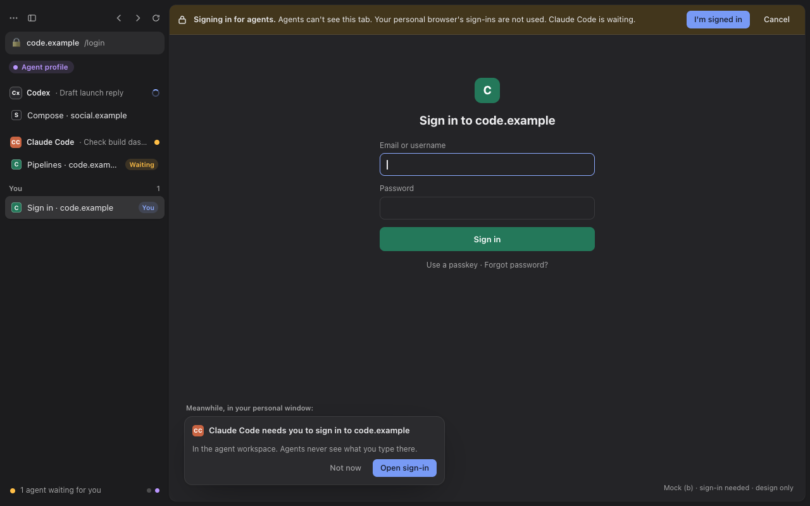
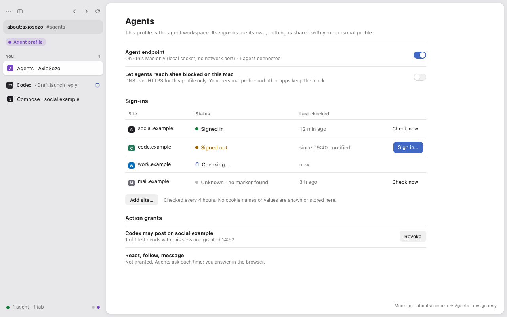
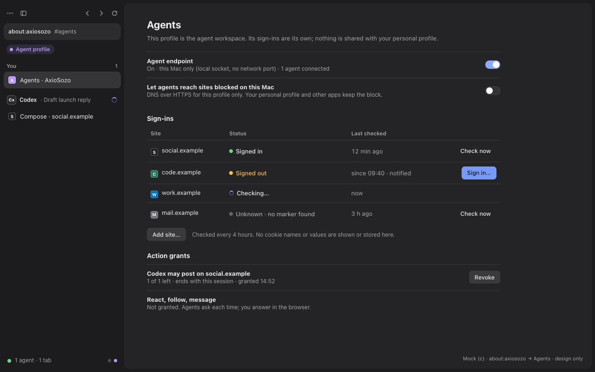
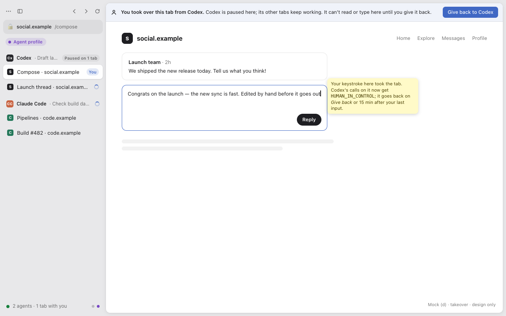
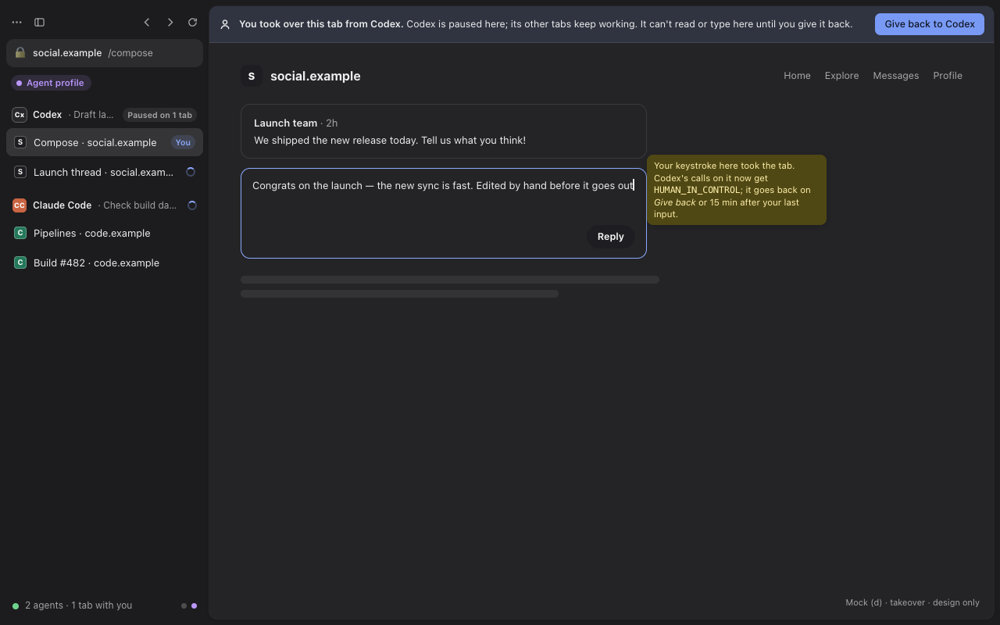

# Agent workspace: the agent browser, built into AxioSozo

Status: **design only** (12 November 2026). No product code has changed. Each
phase in §9 is a separate task. Nothing here is READY (see
[setup status](../SETUP_STATUS.md)), and nothing replaces the real macOS E1/E2
gates (AGENTS.md, [ADR 002](../adr/002-dual-engine.md)).

The mocks in §5 are HTML and CSS built on the browser's real Lab kit
stylesheet (`apps/browser/chrome/lab/lab.css`) and presence stylesheet
(`lab/presence/presence.css`), with Zen's theme tokens filled in by hand.
`src/render.sh` renders them in a headless browser at 1280×800, in light and
dark. These surfaces have no chrome modules yet, and the headless-Gecko
harness used for [projects](projects.md) is not in the repository, so the
mocks are not drawn by real modules and are not screenshots of a built Zen
window. Sources and renders are in
[`assets/agent-workspace/`](assets/agent-workspace/).

## 1. What this replaces

Coding agents use a browser today, and it is not this one. A separate
automation Chromium (here called **the agent Chrome**) runs headless next to the
user's own browser. A set of local scripts and login items keeps it alive,
gives it its own logins, lets it reach sites the Mac blocks for the human,
hides it when the human touches it, and checks its logins every few hours. A
third-party MCP server attaches to its debugging port, and several agents
share it at once.

This works, but it needs a second browser, a debugging port that any local
process can use, a root-installed proxy policy, and a restart whenever the
human logs in. It also enforces ownership only by convention: "never touch
another agent's page" is a written rule, not something the browser stops.

This design does all of that inside AxioSozo: a separate **agent profile** in
the same Zen/Gecko application, with both engines, one tool surface, and the
safety rules enforced by the browser. The existing P4 agent bridge
([agent-channel-v1](../../contracts/agent-channel-v1.md),
`AgentBridgeRuntime`) remains how a coding agent works with the user's
*personal* profile, with an Allow-once confirmation for every action. The
agent workspace is a second mode of the same channel, running in the agent
profile only.

## 2. Capability inventory and mapping (A1–A12)

Status: **exists** (the browser can do it today, possibly behind a literal
gate), **extend** (an existing module grows), **new** (nothing exists yet) or
**drop** (not carried over, with the reason).

| # | Today (agent Chrome) | Native in AxioSozo | Builds on | Status |
| --- | --- | --- | --- | --- |
| A1 | **Separate agent profile.** Its own user-data directory with its own logins on several sites. Copying cookies from the personal browser was tried and retired: an identity provider revoked a session shared between two browsers, in both of them. | A separate Gecko **profile** with role `agent`, run as a second instance of the same app (§3.2). Its own cookie jar, storage, password store and history, plus its own Chromium profile, because the CEF host keeps one Chromium profile per Zen profile ([cef-v1](../../contracts/cef-v1.md) "Process and authentication"). There is no import, copy or sync from any other profile, and no tool exposes cookies. | Gecko profiles; `CEFEngineAdapter` (one host per Zen profile, `<session>/chromium` beside `<session>/gecko`); `ProjectContainers` (not used for isolation, see §3.2) | **extend** (profile role, launcher and Settings are new; the cookie separation per Zen profile exists) |
| A2 | **Egress proxy.** A loopback HTTP/CONNECT proxy re-resolves names over DNS-over-HTTPS when the system resolver answers with a hosts-file block. Local names, the mesh VPN suffix and private and CGNAT ranges bypass it. It logs only errors. A root script installs a mandatory proxy policy for the agent Chrome. | **Per-profile egress rule** (§3.3). An opt-in setting of the agent profile makes Gecko resolve hosts-blocked names through DoH (stock TRR prefs) and makes the agent profile's CEF host do the same (Chromium secure DNS, with a profile-owned resolver child as fallback). Personal profiles keep the system block, and the setting does not exist there. | Gecko TRR (`network.trr.*`); `CEFEngineAdapter` request context; `ProjectRunner` pipe lease (for the fallback child) | **new** |
| A3 | **Always-on headless instance.** A login item keeps it running with a debugging port on loopback, restarts it when it dies, and loads an AI-assistant extension. | The agent profile instance is a **login item of the app itself** (user-visible, restarted on crash) and runs without a window until a human needs one (§3.6). There is no debugging port: agents reach it through the profile's own Unix-socket agent endpoint. | `AgentChannelService` (endpoint states), `AgentChannelConfig` (`agentProfileSocketPath`: one socket per profile), `AgentSocketLease` | **extend** (persisted enablement for the agent role and the login item are new) |
| A4 | **MCP server** (a third-party DevTools MCP server on the debugging port): pages, navigation, snapshot, input, upload, dialogs, waits, screenshots, script, console and network listing, emulation, resize, performance trace and insights, audit, heap snapshot, screencast. Several agents share it; each opens its own page and keeps its page id. Some sites never finish loading, so agents snapshot again. | **Workspace mode of `packages/agent-bridge`.** The tool names and arguments match one to one (§7.1). Each agent session sees, reads and drives only its own tabs, and the browser enforces this (§3.4). Gecko tabs run through in-process WebDriver BiDi, Chromium tabs through CEF's in-process DevTools messages (§3.5). A navigation that never finishes returns `still_loading` instead of hanging. | `packages/agent-bridge` (MCP stdio server), `AgentTabRegistry`, `GeckoAgentTools`, `GeckoBiDiReadSession`, `AgentActionRuntime`/`AgentActBoundary`, `AgentCaptureRuntime`, `ConsoleErrorsService`, CEF host | **extend** (channel, bridge and BiDi seams exist; owner sessions, the full tool set and the CEF DevTools path are new) |
| A5 | **Input guard.** Whenever human keyboard or mouse input reaches the agent Chrome (frontmost, under the pointer, or through screen sharing), every one of its processes is hidden. A pause of up to 15 minutes allows human use. | The **takeover rule** (§5.4), per tab: native human input in an agent-owned tab hands that tab to the human. Its agent is paused there (`HUMAN_IN_CONTROL`), no reads or input reach it, and every other agent keeps working. **Give back** returns it. Nothing is hidden, because the agent profile runs without windows by default. | `AgentTabRegistry` (owner field), `AgentActionRuntime` (navigation and invalidation hooks), `CEFPresenter` (knows which input came from the OS) | **new** |
| A6 | **Login flow.** A script pauses the guard, stops the headless instance and opens the same profile in a window at the site's login page. When the human quits it, the headless instance restarts and an auth check runs. Agents lose the browser meanwhile. Agents never log in; they ask the human to run the script. | The **login-needed flow** (§5.2). An agent calls `request_human_login`. The human gets a notification in the personal window, signs in inside a **human-owned** tab of the agent profile that no agent can see, and clicks *I'm signed in*. The waiting agent resumes. Nothing restarts and other agents keep running. | `AgentStatusRuntime` (window notifications, "Go to project"), `AxioSozoToast`, login status (A7) | **new** |
| A7 | **Auth watch.** A login item visits each configured site every 4 hours in a background tab (which also keeps sessions warm), decides signed-in or signed-out per site, stores the state, notifies on a logout (at most daily) and prints the last state without starting a browser. It never prints cookie values. | **Per-site login status** (§5.3). The same four fields per site (probe URL, login URL, signed-in marker, signed-out marker) live in the agent profile. A browser-owned probe tab, owned by `system` and invisible to agents, runs every 4 hours and on demand. Agent tabs also report passively when they hit a site's login page. There is a Settings table, a daily-at-most notification and a read API (§7.2) that answers without loading any page. | `JsonStore` (atomic profile-local JSON), `AxioSozoToast`, about:axiosozo Settings | **new** |
| A8 | **AI-assistant extension** (the Codex extension) loaded unpacked into the agent profile, with a side panel. The desktop app's browser plugin drives the same browser. | First choice: the assistant attaches over the **workspace MCP endpoint**, which Codex supports natively (§7.3). Second: a Gecko build of the extension installed in the agent profile through the normal add-on path. Loading a Chrome extension into the CEF host is not relied on. | `packages/agent-bridge` (Codex config snippets exist), Gecko add-on manager | **extend** (MCP) / **migration** (extension) |
| A9 | **Two Macs.** The same install on both, as a user half and a root half. A cookie sync between the Macs exists but is disabled. | The browser's own install on each Mac, each with **its own agent profile and its own logins**. Nothing syncs logins between Macs. The root half goes away because nothing needs a system proxy policy any more (§3.3). The **cookie sync is dropped**: synced sessions are what got revoked (A1). | `scripts/storage.py`/`./dev setup` (dev builds); release packaging for users | **exists** (install) / **drop** (root half, cookie sync) |
| A10 | **Observability.** An external tool-call monitor tracks the speed and failures of agent browser calls. | The workspace endpoint keeps a **per-call metrics record** (method, engine, duration, outcome code; no URLs, arguments or page content) in RAM. An opt-in append-only file in the agent profile lets the external monitor read it. The bridge also reports which backend served a call (§8). | `AgentChannelCore` (bounded per-request lifecycle, error codes), `ProjectAgentActivity` (bounded RAM history pattern) | **new** |
| A11 | **Consumers in flight.** A marketing-platform table needs the login status per platform and lets agents post, reply and message through the agent browser. Its needs define the login-status API and the action grants. | The **login-status read API** (§7.2) and **action grants** (§6.2): post, react, follow and message, each granted explicitly by the human per class, site and count. The consumer reads status without driving a page. | Login status (A7), action grants (new), `AgentChannelCore` codes | **new** |
| A12 | **Policy.** Agents post, like, follow or message only when the human asked. They never touch other agents' pages, never work around the hosts block in other apps, and never copy cookies between browsers. | **Browser behaviour instead of written policy** (§6): action-class grants, owner-only tab access, an egress rule scoped to one profile and no cookie-export tool. Agents never enter credentials, and the browser refuses when they try. | `AgentActBoundary` (one-shot dispatch gate), `AgentTabRegistry`, `isSensitiveHost` | **extend** |

## 3. Architecture

### 3.1 Processes, profiles and the agent channel

The same diagram as an image:
[`assets/agent-workspace/architecture.svg`](assets/agent-workspace/architecture.svg).

- **Two instances of one app.** The personal profile and the agent profile
  are two processes of the same AxioSozo/Zen build. Each has its own parent
  process, content processes, CEF host and Chromium profile. They share no
  profile directory, cookie, cache, password store, add-on or preference.
- **One channel, two modes.** Both run the same `AgentChannelService`, each on
  its own profile socket (`<profile>/.a/s`, agent-channel-v1 §1). The personal
  endpoint keeps the P4 rules unchanged. The agent endpoint serves the
  workspace tools (§7.1) under the rules of §6.
- **A summary goes from the agent instance to the personal one**, never the
  reverse. The personal window shows how many agents work, on which hosts and
  in which state, and can bring the agent window forward (§5.1). The summary
  carries no URLs beyond the host, no page content and no cookies.

### 3.2 The agent profile (A1)

- **Created once from Settings.** about:axiosozo → Agents → *Set up the agent
  workspace* creates a new Gecko profile through the profile service. Its
  `axiosozo/profile-role.json` file says `{"role":"agent"}` and is written only
  by that privileged action. Prefs, pages and agents cannot create or change a
  role. A profile without the file is `personal`.
- **Why a profile and not a container or a space.** Containers
  (`ProjectContainers`) separate cookies, but they share the password store,
  history, add-ons, network prefs (DoH is per profile) and the CEF host, which
  is per Zen profile. A Zen space only groups tabs. A1's requirement, that a
  session never lives in both browsers, needs the whole profile apart, and
  only a profile can carry its own egress rule (§3.3).
- **Logins come only from the human signing in** (§5.2). The agent profile
  turns password autofill on page load off (`signon.autofillForms=false`), so a
  saved login is never filled into a page an agent opened. The human can still
  fill one by hand.
- **No import, copy or sync.** No cookie, storage or password import from
  another profile or browser is offered. Firefox Sync's login and history
  engines are off in the agent profile, and Settings explains why.
- **Containers inside the agent profile** stay available. One use is a second
  account on the same site for a different project. They do not replace the
  profile boundary.

### 3.3 Per-profile egress rule (A2)

The loopback proxy and its root-installed policy are replaced by a setting of
the agent profile: **"Let agents reach sites blocked on this Mac"** (off by
default, shown only when the role is `agent`).

- **Gecko.** With the setting on, the agent profile writes stock prefs at
  startup: `network.trr.mode=3` (DoH only), `network.trr.uri` set to the chosen
  resolver, and `network.trr.exclude-etc-hosts=false`, so that names the hosts
  file blocks are resolved through DoH. Local names stay on the system
  resolver: `network.trr.excluded-domains` holds `localhost`, `local`, the mesh
  VPN suffix entered by the user and any other private suffix, and
  `network.trr.allow-rfc1918=false` keeps private answers out. Personal
  profiles never get these prefs.
- **Chromium (agent profile's CEF host).** The host starts with Chromium's
  secure DNS in `secure` mode and the same template, set on the request
  context. Whether Chromium on macOS still applies the hosts file before secure
  DNS is **unverified**. If it does, the agent instance starts a
  profile-owned resolver child for its CEF host only: the same rule as today's
  proxy (system answer first, DoH only when the answer is a block), on a
  loopback port with a random token. Its pipe is the lease, as in
  `ProjectRunner`, so the child dies with the instance. The CEF request context
  points at it. It is never a system-wide policy.
- **What stays the same.** The system hosts block is not touched. Other apps
  and the personal profile keep it. Errors only are logged, and no
  per-request log of names is kept.
- **Opt-in, scoped, visible.** The setting is per profile, needs a trusted
  click, and shows in the agent window's identity panel ("This profile uses DNS
  over HTTPS").

### 3.4 The agent endpoint for several agents (A3, A4)

- **Off until Settings turns it on, loopback only.** As today, every process
  starts with the endpoint off, and only the explicit Settings action in a
  normal window enables it (agent-channel-v1 §1). The transport stays a Unix
  socket (mode 0600, directory 0700, no TCP listener). **The only change, for
  the `agent` role:** the trusted Settings action also records "enabled for
  this profile" in `profile-role.json`, so a crash restart or a login brings
  the endpoint back without a click. A saved pref alone still enables nothing,
  and personal profiles keep the exact per-process rule. Turning it off in
  Settings clears the record and closes every session. This is a change to
  agent-channel-v1 §1, owned by the integration lead (phase 3).
- **Sessions without a prompt in the agent profile.** In the personal profile
  every session needs *Allow for this session*. In the agent profile the human
  already chose to give the profile to agents, so a `hello` from
  `agent-bridge` in workspace mode is admitted at once and listed in the
  Agents panel (§5.1) with *Disconnect*. Settings offers *Ask before a new
  agent connects* (off by default). Limits rise from 8 to 16 connections; each
  session may own at most 24 tabs.
- **Every tab has one owner.** `AgentTabRegistry` gains an `owner` field: a
  session id `s_…`, `human`, or `system` (the login probe). `new_page` creates
  a tab owned by the caller. A pop-up inherits its opener's owner. Every read
  and every input checks `owner === session` before anything else runs, and
  fails with `NOT_OWNER` otherwise. `list_pages` returns only the caller's tabs
  plus a count of tabs it cannot see. The rule "keep your page id and never
  touch another agent's page" is now enforced by the browser.
- **Resuming.** The bridge receives a resume token in `welcome` and keeps it
  in memory. When a session's connection drops, its tabs become **parked** for
  10 minutes: still owned, but visible to no one. A reconnect with the token
  within that time takes them back. After that, parked tabs close unless the
  human adopts them in the Agents panel.
- **Human hand-over.** The human can give one of their own agent-profile tabs
  to an agent (*Give to…*), take one (§5.4), or close any tab. Agents can
  never give tabs to each other.

### 3.5 One tool surface over two engines

| Layer | Gecko tabs | Chromium tabs |
| --- | --- | --- |
| Transport into the engine | In-process WebDriver BiDi sessions without a listener, as `GeckoBiDiReadSession`/`AgentActionRuntime` build them today: RemoteAgent and Marionette stay off and no port opens | CEF's in-process DevTools message API (`SendDevToolsMessage` and a message observer) inside the host, reached through new cef-v1 messages `devtools.attach`/`devtools.send`/`devtools.event` on the existing authenticated stdin/stdout pipe. No debugging port, no WebSocket |
| Snapshot (`take_snapshot`) | The Gecko accessibility tree of the tab's document, read in the parent, with stable `uid`s per node and document | The CEF accessibility tree that `engine-accessibility.md` already streams to Zen, or `Accessibility.getFullAXTree` |
| Input | BiDi `input.performActions`, `input.setFiles` | CDP `Input.dispatch*`, `DOM.setFileInputFiles` |
| Script | BiDi `script.callFunction` in a sandbox realm | CDP `Runtime.callFunctionOn` in an isolated world |
| Console and network | `ConsoleErrorsService` (extended to every level); BiDi `network.*` events | CDP `Runtime`/`Log`/`Network` events |
| Screenshot | BiDi `browsingContext.captureScreenshot` (`AgentCaptureRuntime`, today behind a literal `false`) | CDP `Page.captureScreenshot` |
| Only one engine has it | — | performance trace and insights, audit, heap snapshot (CDP domains) |

The browser filters both paths the same way before anything is dispatched:
the owner check (§3.4), the takeover state (§5.4), the credential rule
(§6.1), action grants (§6.2), private and sensitive hosts (`isSensitiveHost`)
and the bounds already in `AgentChannelCore` (`CHANNEL_LIMITS`). The CEF host
accepts only an allowlist of DevTools methods per attached target, keyed by
the browser-issued target identity and generation (cef-v1). A tab that
switches engine keeps its `tab_id` and owner, and a call in flight during the
switch fails with `UNAVAILABLE` and is never replayed.

### 3.6 Lifecycle: always available (A3)

- **Login item.** Settings registers the agent instance as a login item of the
  app, so it is visible in the system's login items. It starts the app with
  the agent profile and without a window, and it restarts after a crash. On
  macOS the instance stays an accessory app (no Dock icon) until it shows a
  window for sign-in, takeover or the Agents panel.
- **Quitting** the agent instance from its menu or the Agents panel stops it
  until the next login or *Start agent workspace*. Agents then get the
  fallback of §8.
- **Shutdown** follows the existing rules: the endpoint and its sessions close
  first, owned children (CEF host, resolver child) get their pipes closed, and
  only this instance's process groups are touched.

### 3.7 Two Macs (A9) and observability (A10)

- Each Mac sets up its own agent profile and signs in on its own. Nothing in
  this design moves cookies or sessions between Macs.
- Metrics: one record per call `{at, session, method, engine, ms, code}` in a
  RAM ring of 2,048 entries. With *Share tool metrics* on, records are
  appended to `axiosozo/agent-metrics.jsonl` in the agent profile, rotated at
  1 MiB. Nothing in it names a URL, an argument or page content.

## 4. What the human sees at a glance

| Place | What it shows |
| --- | --- |
| Personal window, sidebar footer | An **Agents** entry when the agent workspace runs: a ring while agents work, amber when one needs you (sign-in, grant), red when the endpoint failed. Click → the Agents panel in the agent window |
| Agent window, sidebar | Tabs grouped **by owner**: one section per agent session (agent name, task title, state), then *You* (human-owned tabs), then *Parked* |
| Agent window, Agents panel | Every session: agent, task, tabs, last call and its result, *Disconnect*; the endpoint state; the grants in force |
| about:axiosozo → Agents (Settings) | Workspace on/off, endpoint on/off, the egress setting, the per-site sign-in table, grants and their history, metrics sharing |

## 5. Native UI: the four flows

All four use Zen's own material: the sidebar, the notification bar
(`notificationbox`), the doorhanger and toast (`AxioSozoToast`), and the Lab
kit card (`lab.css`). Text is set as text, never markup. Each mock comes in
light and dark.

### 5.1 (a) Which tabs agents own and what they do

- The agent window's sidebar groups tabs by owner. Each agent section shows
  the agent's name and icon, the task title it gave in `hello` (or "Untitled
  task"), and its state: working (a slow ring, as in the Lab presence
  experiment), waiting for you (amber), idle, or paused by you.
- A tab row carries a small owner badge. A tab an agent is acting on right now
  shows the current action in its tooltip ("Typing into Search").
- The **Agents panel** (a Lab-kit card over the content, top right) lists every
  session: the agent, its task, how many tabs it owns, its last call and the
  result code, and how long ago it ran. *Disconnect* closes the session and
  parks its tabs. The header shows the endpoint state ("On · this Mac only ·
  2 agents") and the egress setting when it is on.
- In the personal window, the **Agents** entry shows the same summary in one
  line and opens this panel.

### 5.2 (b) Sign-in needed

1. An agent that hits a login wall, or whose call returns
   `LOGIN_REQUIRED` (§6.1), calls `request_human_login({site, reason})`. The
   call returns at once with `{request_id, state:"waiting"}`. The agent can
   call `wait_for_login({request_id, timeout})` or keep working elsewhere.
2. The browser shows **one** request per site, however many agents ask: a
   toast in the personal window ("Codex needs you to sign in to
   social.example · in the agent workspace") with *Open sign-in*. If no
   personal window is open, a system notification appears instead. The
   Agents entry turns amber.
3. *Open sign-in* brings the agent window forward with a new **human-owned**
   tab at the site's login URL. No agent can list, read, screenshot or drive
   it. A notification bar says: "Signing in for agents. Agents can't see this
   tab. Your personal browser's sign-ins are not used." with *I'm signed in*
   and *Cancel*.
4. The human signs in however they like (typing, their own password manager,
   a passkey, two-factor). The browser never gives an agent anything typed
   here.
5. *I'm signed in* (or the site's signed-in marker, §5.3) closes the tab and
   sets the site to *Signed in*. Waiting agents get `{state:"signed_in"}` and
   carry on. Nothing restarts, and no other agent was interrupted.
6. *Cancel* or 30 minutes without an answer resolves the request as
   `{state:"declined"}`.

### 5.3 (c) Sign-in status per site

- about:axiosozo → Agents → **Sign-ins**: one row per site with its state
  (*Signed in*, *Signed out*, *Not checked*, *Checking…*), when it was last
  checked, and *Sign in…* (the flow of §5.2) or *Check now*. *Add site…* takes
  the four fields of a probe. Rows show no cookie names or values.
- **The probe.** Every 4 hours, and on *Check now*, a `system`-owned
  background tab in the agent profile loads each site's probe URL and decides:
  the signed-out marker means signed out, the signed-in marker means signed
  in, and anything else (an error, a timeout, neither marker) means *unknown*,
  never signed in. The probe runs one site at a time, keeps sessions warm as
  today, and never runs while that site's sign-in tab is open.
- **Passive updates.** When an agent tab lands on a site's login URL or
  signed-out marker, that site turns *Signed out* immediately.
- **Notification.** A change to *Signed out* raises at most one notification
  per site per day.
- The same section holds **Action grants** (§6.2) and the endpoint and egress
  switches, so the Agents settings page is the one place for agent safety.

### 5.4 (d) Takeover: a human types into an agent's tab

- **Trigger.** Native human input in the content of an agent-owned tab:
  keyboard, click, wheel, or touch, including input that arrives through
  screen sharing or a shared keyboard. Gecko tells this apart from automation
  in the parent: the BiDi input dispatcher marks its own events, while human
  events arrive from the widget (to be checked against the pinned Gecko in
  phase 6). For Chromium tabs, `CEFPresenter` forwards OS events itself, so it
  knows which input is human. Hovering, scrolling the sidebar or focusing the
  window is not a takeover.
- **Effect, at once and per tab.** The tab's owner becomes `human`, with the
  previous agent remembered. That agent's pending input on the tab is
  cancelled. An effect already dispatched may finish, and nothing is replayed
  (agent-channel-v1 §4.2). Every further call on the tab, reads included, gets
  `HUMAN_IN_CONTROL` with `retry_after`. Reads are paused too, so an agent
  never sees what the human types. Other tabs and other agents are not
  affected.
- **What the human sees.** A notification bar: "You took over this tab from
  Codex. Codex is paused here; its other tabs keep working." with *Give back
  to Codex*. The tab's badge changes to *You*.
- **Ending it.** *Give back* returns the tab to the agent. The tab also goes
  back by itself 15 minutes after the last human input (today's pause limit),
  but never while a password or one-time-code field has focus. Closing the tab
  ends it too. A tab returned with a different document (the human navigated)
  gets a new document id, so the agent's old `uid`s are stale and it must
  snapshot again.

## 6. Agent-safety rules as browser behaviour

These rules apply in the agent profile. The personal profile keeps every P4
rule (agent-channel-v1 §4), which is stricter.

### 6.1 Agents never enter credentials

- `fill`, `fill_form`, `type_text`, `press_key` and `upload_file` are refused
  with `CREDENTIALS_HUMAN_ONLY` when the target, or the focused element for
  key input, is a password field; has `autocomplete` `current-password`,
  `new-password` or `one-time-code`; is a field Gecko's login-form detection
  marks as a username or password field; or is a Chromium node exposed as a
  secure text field (the engine-accessibility tree). The browser then raises
  §5.2 for that site.
- `click` on the submit control of a form that contains a password field is
  refused the same way. So are `handle_dialog` with text for an HTTP
  authentication prompt, and any WebAuthn or passkey prompt, which only a
  human can answer.
- A saved login is never filled on load (§3.2). No tool returns cookie values
  or authentication headers: network listings redact `Cookie`, `Set-Cookie`,
  `Authorization` and `Proxy-Authorization`. No cookie-store tool exists.
- Limit, stated plainly: `evaluate_script` runs in a sandbox realm, and that
  realm can still read cookies a page left readable to its own scripts. It
  cannot read `HttpOnly` session cookies. Sites in a sensitive category
  (`isSensitiveHost`) refuse `evaluate_script` entirely.

### 6.2 Posting, reacting, following and messaging need a human grant

- **Classes:** `post` (publish, reply, comment, repost), `react` (like,
  upvote, reaction), `follow` (follow, connect, subscribe) and `message`
  (direct message, chat, mail send).
- **Grant.** A grant is `{session, site, class, count, expires}` and comes only
  from a trusted click in browser UI. An agent asks with
  `request_grant({site, class, count, reason})`, which shows a doorhanger in
  the agent window and a toast in the personal one: "Codex wants to **post**
  on social.example **once**: Reply to a launch thread." with *Allow* and
  *Deny*. The human can also grant ahead of time in Settings ("Codex may post
  on social.example 3 times in the next hour"). Each grant is used up per
  action, ends with its session, and can be revoked at once.
- **Enforcement, two layers.**
  1. *Before dispatch.* Each site with grants rules (a bundled, editable
     `action-rules.json`) lists, per class, the controls and form targets
     that perform it, by role and accessible name, by form action, or by
     request URL pattern. A `click`, `press_key` (Enter) or form submission
     whose target matches a class without a live grant fails with
     `GRANT_REQUIRED {site, class}`, and nothing is dispatched.
  2. *At the network.* In the agent profile, a non-GET request to a guarded
     site's first-party origins that follows an agent action in that tab
     (input, evaluate_script, or navigation, within 5 seconds) is held. Gecko
     catches it in `http-on-modify-request`, Chromium in the host's resource
     request handler. If it matches a class, it needs that class's grant. If
     it matches a known harmless write (an analytics beacon, a draft
     autosave), it passes. **Otherwise it is held as `post`**, the strictest
     class, and the human can allow it once from the doorhanger. Fail closed:
     an unknown write on a guarded site never goes out unseen.
- **Not guarded:** sites without rules. This design does not claim that the
  browser recognises every social action on every site. It guards the sites
  the human lists. Adding a site is one Settings action, and an unknown site
  counts as unguarded only until it is added.

### 6.3 Agents read and drive only their own tabs

Owner checks happen in the parent before any engine call (§3.4). `NOT_OWNER`
reveals nothing about the other tab, not even whether it exists. The login
probe's `system` tabs and the human's tabs are never listed to an agent.
`list_pages` counts them only as "tabs you can't see: N".

### 6.4 The endpoint stays off until Settings, and stays on this Mac

- Default off, and only a trusted Settings click enables it (§3.4). No pref,
  environment variable, page or agent can turn it on. It is loopback only, and
  stricter than a loopback port: a local Unix socket that only the same user
  can open. There is no TCP listener, no debugging port and no WebSocket. The fallback resolver
  child of §3.3 listens on loopback for the CEF host only, with a random
  token, and serves no agent.
- The endpoint never exists in a profile whose role is not `agent` in
  workspace mode, and the personal endpoint never serves workspace tools.

## 7. What consumers get

### 7.1 MCP server, equivalent to the DevTools MCP server (A4): drop-in

The workspace mode of `packages/agent-bridge` (`--workspace`) offers **the same
tool names and the same arguments** as the DevTools MCP server version that
agents use today (1.12, with the options the current setup passes). An agent's
MCP entry changes its command, and nothing in its prompts or skills changes.
Differences in behaviour are the safety rules themselves: other agents' pages
are invisible, credentials are refused, and gated actions ask for a grant.

| Tool (same name) | Gecko tab | Chromium tab | Status |
| --- | --- | --- | --- |
| `list_pages` | registry, own tabs only | same | extend (`tabs.list`) |
| `new_page` | BiDi `browsingContext.create`, owned by the caller; engine per site preference (`EnginePreference`) or optional `engine` | Zen tab in Chromium (`EngineTabs`) | extend (`tabs.open`, gated `false` today) |
| `select_page` | bridge-side current page; `bringToFront` never steals focus from the human | same | new |
| `close_page` | own tabs only | same | new |
| `navigate_page` (url, back, forward, reload, `initScript`) | BiDi `navigate`/`traverseHistory`/`reload`, `script.addPreloadScript`; returns `still_loading` after the timeout | CDP `Page.navigate`, `Page.addScriptToEvaluateOnNewDocument` | extend (`tabs.navigate`) |
| `take_snapshot` | Gecko accessibility tree with `uid`s | CEF accessibility tree | new |
| `wait_for` | text match over the snapshot | same | new |
| `click`, `hover`, `drag` | BiDi `input.performActions` | CDP `Input.dispatchMouseEvent` | extend (`page.click`) |
| `fill`, `fill_form`, `type_text`, `press_key` | BiDi input + §6.1 checks | CDP `Input.insertText`/`dispatchKeyEvent` + §6.1 | extend (`page.type`) |
| `upload_file` | BiDi `input.setFiles`; only files under the workspace's uploads folder | CDP `DOM.setFileInputFiles`, same folder rule | new |
| `handle_dialog` | BiDi `browsingContext.handleUserPrompt` (never for HTTP authentication) | CDP `Page.handleJavaScriptDialog` | new |
| `take_screenshot` | BiDi `captureScreenshot` (`AgentCaptureRuntime`) | CDP `Page.captureScreenshot` | extend (`tabs.screenshot`) |
| `evaluate_script` | BiDi `script.callFunction`, sandbox realm | CDP `Runtime.callFunctionOn`, isolated world | new |
| `list_console_messages`, `get_console_message` | `ConsoleErrorsService`, every level | CDP `Runtime`/`Log` | extend (`console.errors`) |
| `list_network_requests`, `get_network_request` | BiDi `network` events and data collection, credential headers redacted | CDP `Network`, same redaction | new |
| `get_css_styles` | computed style through sandbox script | CDP `CSS` | new |
| `emulate` | BiDi `emulation` (geolocation, locale, user agent, colour scheme); CPU and network throttling unavailable on Gecko | CDP `Emulation`/`Network` | new (partial on Gecko) |
| `resize_page` | BiDi `browsingContext.setViewport` | CDP `Emulation.setDeviceMetricsOverride` | new |
| `performance_start_trace`, `performance_stop_trace`, `performance_analyze_insight` | `UNAVAILABLE` (the Gecko profiler format has no insight model) | CDP `Tracing` + the DevTools trace model in the bridge | new (Chromium only) |
| `lighthouse_audit` | `UNAVAILABLE` | the audit library in the bridge over a filtered DevTools session | new (Chromium only) |
| `take_heapsnapshot` | `UNAVAILABLE` | CDP `HeapProfiler` | new (Chromium only; off in today's setup) |
| `screencast_start`, `screencast_stop` | periodic `captureScreenshot` frames | CDP `Page.startScreencast` | new |
| extension, PWA, WebMCP and DevTools-comment tools, `click_at`, `get_tab_id`, the heap-analysis family, slim mode | — | — | drop (off in today's setup; can be added later) |

New tools beyond the DevTools MCP server's set, which an agent that does not
know them never calls: `request_human_login`, `wait_for_login`,
`login_status`, `request_grant`, `list_grants`.

For Chromium-only tools on a Gecko tab, the error text says so and suggests
`new_page` with `engine:"chromium"`. The bridge runs the audit and trace
libraries against a **filtered DevTools session through the channel**
(`cdp.send` for one owned Chromium tab, with an allowlisted method set),
never against a port.

### 7.2 Sign-in status read API (A7, A11): migration

The consumer today reads a state file that the auth watch writes. Natively:

- **Channel method** `status.read` with `{}` (client name `workspace-status`,
  read-only, no session approval, no tab access). It returns
  `[{site, state: "signed_in"|"signed_out"|"unknown"|"checking", since, checked_at, notified_at}]`,
  the same fields as today's state file, plus `checking`.
- **CLI** `axiosozo-agent status --sign-ins [--json]` prints the same data
  from the profile's `agent-signins.json` without starting a browser, as
  today's `status` command does.
- **No cookie names or values, no account names**, only the site key the
  human chose.
- **Migration:** the consumer switches its reader from the state file to the
  CLI or `status.read`. The field names stay the same, so the table's logic
  does not change. Its posting and messaging steps move to the grant flow of
  §6.2. That is a behaviour change by design: every post now needs a grant.

### 7.3 Attaching the AI-assistant extension or its successor (A8): migration

1. **Preferred:** the assistant's desktop app and its coding agent connect to
   the workspace MCP endpoint like any other agent (Codex supports MCP;
   `packages/agent-bridge` already writes its config). This loses the side
   panel inside the agent browser, and the assistant gets the same tools as
   other agents.
2. **If a Gecko build of the extension exists:** install it into the agent
   profile through the normal add-on install (signed, user-confirmed). Its
   tabs then follow the owner rules, as session `extension:<id>`.
3. **Not relied on:** loading a Chrome extension into the embedded CEF host.
   Extension support in windowless CEF is unverified and would widen the
   host's attack surface.

Until one of these is verified, the extension stays on the legacy agent
Chrome (§8).

## 8. When the AxioSozo agent workspace is not there

Until the last phase lands, every agent keeps working through **one MCP
entry**: the workspace bridge runs as a router.

- On each new session the bridge tries the agent profile socket. If the
  socket is missing, the endpoint is off, or the instance does not answer
  within 2 seconds, it starts the legacy DevTools MCP server as a stdio child
  (`--fallback-command`, set in the agent's MCP config) and forwards every
  call to it. Because the tool names match (§7.1), the agent does not notice.
- **The backend stays fixed for a session**, so page ids never mix. A session
  started on the legacy browser stays there until its pages are closed or the
  session ends.
- Every result says which backend served it (`_meta.backend`), and the
  metrics of §3.7 count fallback calls. Phase 12 uses that count as its exit
  check.
- On the legacy backend, `request_human_login` answers with text telling the
  agent to ask the human to use today's sign-in helper. The grant tools answer
  `UNAVAILABLE`, and today's written policy (A12) still applies.
- With neither backend available: `UNAVAILABLE: no agent browser is running`.
- **The legacy agent Chrome is retired only in the final phase (13), never
  earlier.**

## 9. Phases

Each phase is one task. It ends with its own check, and with real macOS E1/E2
where an engine path is involved. Nothing is called READY without real macOS
E1/E2 (AGENTS.md). The legacy agent Chrome keeps running alongside until
phase 13.

| # | Phase | Acceptance check | E1/E2 relevance |
| --- | --- | --- | --- |
| 1 | **Agent profile role.** Settings action *Set up the agent workspace*, `profile-role.json`, a second instance launched with that profile, autofill on load off, sync engines off. | Unit tests: the role is only written by the trusted action and ignored when forged by a pref. A native run on the loopback fixture: a cookie set in the personal profile is absent in the agent profile and the reverse, for a Gecko tab **and** a Chromium tab. | E1: a Chromium tab renders in the second instance (its own CEF host). E2: none. |
| 2 | **Egress rule.** The opt-in setting; TRR prefs for Gecko; secure DNS for the agent CEF host; the resolver child if Chromium applies the hosts file first. | Unit tests with an injected resolver (a block answer goes to DoH; local, private and mesh-suffix names stay on the system resolver). The personal profile never has the prefs. Hosts-file behaviour checked by hand by the owner, never by editing system files from a task. | E1: Chromium tabs load through the rule. E2: killing the resolver child fails closed (the tab shows a network error) and does not reveal the blocked name to the system resolver. |
| 3 | **Workspace endpoint and owners.** Persisted enablement for the `agent` role (agent-channel-v1 §1 change), sessions without a prompt, 16 connections, `owner` in `AgentTabRegistry`, parking and resume. | Fake-channel tests: two sessions never see or touch each other's tabs (`NOT_OWNER`). Parked tabs return with the token and close after 10 minutes. Personal profiles still start disabled. | None (no engine path). |
| 4 | **Workspace MCP and router.** `agent-bridge --workspace` with every mapped tool name; `--fallback-command` routing; `_meta.backend`. | `tools/list` matches a pinned name and argument list of the DevTools MCP server. The fallback is tested against a fake legacy MCP child, with sticky sessions. | None. |
| 5 | **Gecko tools.** Pages, navigation (`still_loading`), snapshot, input, upload folder, dialogs, waits, screenshots, script, console, network, resize, emulate; the credential rule (§6.1). Lift the literal `false` gates for the agent role only, after ordinary-profile proof. | Fixture tests per tool. Credential refusals for every field kind. An ordinary agent-profile run on fixtures, recorded as evidence. | Gecko only; the macOS run is the ordinary-profile proof. |
| 6 | **Takeover and the agents sidebar** (§5.1, §5.4). Owner groups, badges, the Agents panel, the takeover bar, *Give back*, the 15-minute return. | Native input on an agent tab gives `HUMAN_IN_CONTROL` and synthetic BiDi input does not. Screenshots match the mocks in light and dark. | E1: takeover over a Chromium tab uses the real OS input path (`CEFPresenter`). E2: a host crash during takeover leaves the tab human-owned. |
| 7 | **Sign-in needed and sign-in status** (§5.2, §5.3, §7.2). The probe, passive detection, the daily notification, `status.read`, the CLI. | State machine tests (an unknown result never counts as signed in). One request per site. Agents resume after *I'm signed in* without any restart. Probe tabs are invisible to agents. | E1: a sign-in in a Chromium tab of the agent profile (only if a site's engine preference is Chromium). |
| 8 | **Action grants** (§6.2). `action-rules.json`, the grant UI, both enforcement layers in both engines. | On a fixture "social" site, an unauthorised post is blocked before dispatch and at the network, in Gecko and Chromium. A grant of one allows exactly one. An unknown write is held as `post`. | E1 for Chromium (request handler in the host). E2: a host crash with a held request never lets it through. |
| 9 | **Chromium tool parity.** cef-v1 `devtools.*` messages and the method allowlist; every tool of §7.1 on Chromium tabs, including trace, audit, heap snapshot and screencast. | Host tests with real CEF on fixtures; the allowlist refuses everything else. No port is opened (checked with the system's open-socket listing). | **High.** E1: tools work while the tab renders in Zen. E2: a host kill during a call gives `UNAVAILABLE`, the tab recovers (the Chromium-stopped panel or Gecko), and nothing is replayed. |
| 10 | **Assistant attach** (§7.3). Codex config through MCP; the Gecko extension path if a build exists. | The assistant lists and drives its own pages in the agent profile. | None (Gecko) unless the extension uses Chromium tabs. |
| 11 | **Login item, metrics and two Macs** (§3.6, §3.7). Registration, crash restart, accessory mode, the metrics file, install notes for a second Mac. | Killing the instance brings it back. Metrics hold no URLs (test). A second Mac's setup needs no root step. | E2: a restart after a crash restores endpoint state and parks tabs correctly. |
| 12 | **Consumers switch, shadow period.** Agents' MCP entries point at the router. The marketing table reads `status.read`/CLI. | The router metrics show no fallback calls for 7 days while the agent workspace runs. Every inventory item A1–A12 is checked against §2 on the real Mac. | Real macOS E1/E2 for Chromium in the agent profile must pass before phase 13. |
| 13 | **Retire the legacy agent Chrome.** Remove `--fallback-command` from configs; owner removes the old login items, proxy, policy and profile outside this repo. Agents' instructions drop the legacy sign-in helper. | Phases 1–12 accepted. Real macOS E1/E2 passed. No fallback call in the shadow period. | Final gate: no READY claim without real macOS E1/E2. |

## 10. Open questions and risks

- **Gecko automation marking** (§5.4): whether the pinned Gecko lets the
  parent tell BiDi-dispatched input from widget input without a patch. If it
  does not, a small patch adds a chrome-only flag. Zen workstream, phase 6.
- **Chromium and the hosts file under secure DNS** (§3.3): decides whether the
  resolver child is needed. Phase 2.
- **Two instances of one app on macOS**: the second instance's Dock and window
  behaviour, and single-instance handling for links the OS opens (links always
  go to the personal profile). Phase 1.
- **Action rules age**: site markup changes. The network layer fails closed,
  so a stale rule over-blocks and never under-blocks, but the human then sees
  more prompts. The rules file is editable and versioned.
- **Lifted gates**: capture and act stay literal `false` in the personal
  profile. The agent role needs its own ordinary-profile evidence before its
  gates open (phase 5). That evidence is for the agent role only, and the
  personal profile's gates do not move.
