# Agent workspace: the agent browser, built into AxioSozo

Status: **design only** (12 November 2026, revised 13 November 2026 after the
owner's review, and again on 13 November after the owner's decision on option
B: agents always keep their own profile, and B is a live link from your own
window into that agent space). No product code has changed. Each phase in §9 is a separate
task. Nothing here is READY (see [setup status](../SETUP_STATUS.md)), and
nothing replaces the real macOS E1/E2 gates (AGENTS.md,
[ADR 002](../adr/002-dual-engine.md)).

The mocks in §5 are HTML and CSS built on the browser's real Lab kit
stylesheet (`apps/browser/chrome/lab/lab.css`) and presence stylesheet
(`lab/presence/presence.css`), with Zen's theme tokens and Firefox's container
colours filled in by hand. `src/render.sh` renders them in a headless browser
at 1280×800, in light and dark. These surfaces have no chrome modules yet, and
the headless-Gecko harness used for [projects](projects.md) is not in the
repository, so the mocks are not drawn by real modules and are not
screenshots of a built Zen window. Sources and renders are in
[`assets/agent-workspace/`](assets/agent-workspace/).

## 0. Key decisions

1. **Agents always work in their own space; you look in from your window.**
   (A) The **agent space** (the agent workspace) is a separate agent profile
   with its own identities and sign-ins. Every agent tab lives there, always.
   Your own profile never holds an agent-owned tab or an agent cookie. (B)
   The **linked view** is how you look in: from your own window you see which
   agents are active and what each one is doing, and you can open a live,
   read-only view of an agent tab inside your window. The page keeps running
   in the agent space, with the agent's identity. Taking over is an explicit
   action, and its cookies stay in the agent space. Recommendation: both, as
   one system. A is where agents work, B is how you look in (§3.1, §3.11).
2. **Every tab has exactly one owner**: you, one agent session, or the
   browser. The agent space enforces it for every tab it holds. Your own
   profile holds only your tabs. An agent sees, reads and drives only its own
   tabs (§3.6, §6.3).
3. **Identities: several accounts per site, all signed in at once.** Each
   identity is a Gecko container plus its own Chromium request context. The
   call, the opener tab, a remembered link rule, the agent's default or the
   site's default chooses it. If none of these settles it, the browser asks
   and never guesses (§3.4).
4. **Agent tabs are headless by default.** Watching is on demand and costs
   rendering. A linked view renders only while it is open and shown in your
   window; otherwise the tab stays headless. The browser shows the cost while
   you watch, and closing the view returns the tab to headless (§3.7, §3.11).
5. **Signing in is human-only and never blocks you.** One prompt per site and
   identity, however many agents wait. The prompt appears in your own window
   through the same link. *Sign in* opens the agent space's sign-in page for
   the right identity as a linked view in your window, so the sign-in is
   stored in that agent-space identity and never in your profile. Agents
   resume without a restart, and they never type credentials (§5.4, §6.1).
6. **Account-aware links.** A caller says "open this URL as identity X".
   Without that, a remembered rule, an opt-in lookup or a chooser picks the
   identity. A link never opens in the wrong account silently, and nobody
   signs out and back in (§5.8).
7. **Safety rules are browser behaviour**: owner checks, credential refusal,
   per-class grants for posting, reacting, following and messaging, an
   endpoint that is off until Settings and local only, and an egress rule for
   the agent profile only. The old agent Chrome stays as the fallback until
   the last phase (§6, §8).

## 1. What this replaces

Coding agents use a browser today, and it is not this one. A separate
automation Chromium (here called **the agent Chrome**) runs headless next to the
user's own browser. A set of local scripts and login items keeps it alive,
gives it its own logins, lets it reach sites the Mac blocks for the human,
hides it when the human touches it, and checks its logins every few hours. A
third-party MCP server attaches to its debugging port, and several agents
share it at once.

This works, but it needs a second browser, a debugging port that any local
process can use, a root-installed proxy policy, and a restart whenever the
human logs in. It holds one account per site. It also enforces ownership only
by convention: "never touch another agent's page" is a written rule, not
something the browser stops.

This design does all of that inside AxioSozo, with both engines, one tool
surface, and the safety rules enforced by the browser. The existing P4 agent
bridge ([agent-channel-v1](../../contracts/agent-channel-v1.md),
`AgentBridgeRuntime`) is the base: the agent profile's endpoint runs the
workspace mode of option A. Option B adds no agent endpoint to your own
profile. It is a private link between your browser and the agent space
(§3.11) that carries a summary, the frames of a view you open, and your input
only while you have taken a tab over. The personal profile's P4 endpoint stays
exactly as agent-channel-v1 specifies it; this design adds nothing to it.

## 2. Capability inventory and mapping (A1–A12)

Status: **exists** (the browser can do it today, possibly behind a literal
gate), **extend** (an existing module grows), **new** (nothing exists yet) or
**drop** (not carried over, with the reason).

| # | Today (agent Chrome) | Native in AxioSozo | Builds on | Status |
| --- | --- | --- | --- | --- |
| A1 | **Separate agent profile.** Its own user-data directory with its own logins on several sites, one account per site. Copying cookies from the personal browser was tried and retired: an identity provider revoked a session shared between two browsers, in both of them. | A separate Gecko **profile** with role `agent`, run as a second instance of the same app (§3.3). It has its own cookie jar, storage, password store and history, plus its own Chromium profile, because the CEF host keeps one Chromium profile per Zen profile ([cef-v1](../../contracts/cef-v1.md) "Process and authentication"). Inside it, **identities** (§3.4) hold several accounts per site at once. There is no import, copy or sync from any other profile, and no tool exposes cookies. | Gecko profiles; `CEFEngineAdapter` (one host per Zen profile); `ProjectContainers`/`ProjectAccountRuntime` (containers, identity colours) | **extend** (profile role, launcher and identities are new; the cookie separation per Zen profile exists) |
| A2 | **Egress proxy.** A loopback HTTP/CONNECT proxy re-resolves names over DNS-over-HTTPS when the system resolver answers with a hosts-file block. Local names, the mesh VPN suffix and private and CGNAT ranges bypass it. It logs only errors. A root script installs a mandatory proxy policy for the agent Chrome. | **Per-profile egress rule** (§3.5). An opt-in setting of the agent profile makes Gecko resolve hosts-blocked names through DoH (stock TRR prefs) and makes the agent profile's CEF host do the same (Chromium secure DNS, with a profile-owned resolver child as fallback). Personal profiles keep the system block, and the setting does not exist there. | Gecko TRR (`network.trr.*`); `CEFEngineAdapter` request context; `ProjectRunner` pipe lease (for the fallback child) | **new** |
| A3 | **Always-on headless instance.** A login item keeps it running with a debugging port on loopback, restarts it when it dies, and loads an AI-assistant extension. | The agent profile instance is a **login item of the app itself** (user-visible, restarted on crash). It runs **headless by default** and needs no window of its own: the human watches, signs in and takes over through the linked view in their own window (§3.11). Its own window appears only when the human asks for it (§3.7, §3.9). There is no debugging port: agents reach it through the profile's own Unix-socket agent endpoint. | `AgentChannelService` (endpoint states), `AgentChannelConfig` (`agentProfileSocketPath`: one socket per profile), `AgentSocketLease` | **extend** (persisted enablement for the agent role and the login item are new) |
| A4 | **MCP server** (a third-party DevTools MCP server on the debugging port): pages, navigation, snapshot, input, upload, dialogs, waits, screenshots, script, console and network listing, emulation, resize, performance trace and insights, audit, heap snapshot, screencast. Several agents share it; each opens its own page and keeps its page id. Some sites never finish loading, so agents snapshot again. | **Workspace mode of `packages/agent-bridge`.** The tool names and arguments match one to one (§7.1), and `new_page` gains an optional `identity`. Each agent session sees, reads and drives only its own tabs, and the browser enforces this (§3.6). Gecko tabs run through in-process WebDriver BiDi, Chromium tabs through CEF's in-process DevTools messages (§3.8). A navigation that never finishes returns `still_loading` instead of hanging. | `packages/agent-bridge` (MCP stdio server), `AgentTabRegistry`, `GeckoAgentTools`, `GeckoBiDiReadSession`, `AgentActionRuntime`/`AgentActBoundary`, `AgentCaptureRuntime`, `ConsoleErrorsService`, CEF host | **extend** (channel, bridge and BiDi seams exist; owner sessions, the full tool set and the CEF DevTools path are new) |
| A5 | **Input guard.** Whenever human keyboard or mouse input reaches the agent Chrome (frontmost, under the pointer, or through screen sharing), every one of its processes is hidden. A pause of up to 15 minutes allows human use. | **Watch and takeover, per tab** (§3.7, §3.11, §5.2, §5.6, §5.7). The human watches any agent tab on demand, from their own window through the linked view or in the agent space's window. In the linked view only the explicit *Take over* hands the tab to the human; in the agent space's window the first native input does, and that input is not delivered to the page. The tab's agent is paused there (`HUMAN_IN_CONTROL`), no reads or input reach it, and every other agent keeps working. **Give back** returns it. Nothing needs hiding, because agent tabs are headless until watched. | `AgentTabRegistry` (owner field), `AgentActionRuntime` (navigation and invalidation hooks), `CEFPresenter` (knows which input came from the OS) | **new** |
| A6 | **Login flow.** A script pauses the guard, stops the headless instance and opens the same profile in a window at the site's login page. When the human quits it, the headless instance restarts and an auth check runs. Agents lose the browser meanwhile. Agents never log in; they ask the human to run the script. | The **sign-in prompt** (§5.4). An agent calls `request_human_login`, or the browser detects an expired session mid-task. The human gets one non-blocking prompt per site and identity, signs in inside a **human-owned** tab of the right identity in the agent space, shown in their own window through the linked view, that no agent can see, and the waiting agents resume. The session lands in the agent space identity, never in the personal profile. Nothing restarts and other agents keep running. | `AgentStatusRuntime` (window notifications), `AxioSozoToast`, Lab kit card, sign-in status (A7) | **new** |
| A7 | **Auth watch.** A login item visits each configured site every 4 hours in a background tab (which also keeps sessions warm), decides signed-in or signed-out per site, stores the state, notifies on a logout (at most daily) and prints the last state without starting a browser. It never prints cookie values. | **Sign-in status per site and identity** (§5.5). The same four probe fields per site (probe URL, login URL, signed-in marker, signed-out marker) live in the agent profile. A browser-owned probe tab, owned by `system` and invisible to agents, checks every site in every identity every 4 hours and on demand. Agent tabs also report passively when they hit a login page. There is a Settings table, a daily-at-most notification and a read API (§7.2) that answers without loading any page. | `JsonStore` (atomic profile-local JSON), `AxioSozoToast`, about:axiosozo Settings | **new** |
| A8 | **AI-assistant extension** (the Codex extension) loaded unpacked into the agent profile, with a side panel. The desktop app's browser plugin drives the same browser. | First choice: the assistant attaches over the **workspace MCP endpoint**, which Codex supports natively (§7.3). Second: a Gecko build of the extension installed in the agent profile through the normal add-on path. Loading a Chrome extension into the CEF host is not relied on. | `packages/agent-bridge` (Codex config snippets exist), Gecko add-on manager | **extend** (MCP) / **migration** (extension) |
| A9 | **Two Macs.** The same install on both, as a user half and a root half. A cookie sync between the Macs exists but is disabled. | The browser's own install on each Mac, each with **its own agent profile, identities and sign-ins**. Nothing syncs logins between Macs. The root half goes away because nothing needs a system proxy policy any more (§3.5). The **cookie sync is dropped**: synced sessions are what got revoked (A1). | `scripts/storage.py`/`./dev setup` (dev builds); release packaging for users | **exists** (install) / **drop** (root half, cookie sync) |
| A10 | **Observability.** An external tool-call monitor tracks the speed and failures of agent browser calls. | The workspace endpoint keeps a **per-call metrics record** (method, engine, duration, outcome code; no URLs, arguments or page content) in RAM. An opt-in append-only file in the agent profile lets the external monitor read it. The bridge also reports which backend served a call (§8). | `AgentChannelCore` (bounded per-request lifecycle, error codes), `ProjectAgentActivity` (bounded RAM history pattern) | **new** |
| A11 | **Consumers in flight.** A marketing-platform table needs the login status per platform and lets agents post, reply and message through the agent browser. Its needs define the login-status API and the action grants. | The **sign-in status read API** (§7.2, per site and identity), **action grants** (§6.2: post, react, follow and message, each granted by the human per class, site and count) and **open as identity** (§7.4) for callers that know which account owns a page. The consumer reads status without driving a page. | Sign-in status (A7), action grants (new), identities (new), `AgentChannelCore` codes | **new** |
| A12 | **Policy.** Agents post, like, follow or message only when the human asked. They never touch other agents' pages, never work around the hosts block in other apps, and never copy cookies between browsers. | **Browser behaviour instead of written policy** (§6): action-class grants, owner-only tab access, identities an agent may use only when the human allows it, an egress rule scoped to one profile and no cookie-export tool. Agents never enter credentials, and the browser refuses when they try. | `AgentActBoundary` (one-shot dispatch gate), `AgentTabRegistry`, `isSensitiveHost` | **extend** |

The owner's review (13 November) added five requirements, and the owner's
decision later that day settled R1: agents always keep their own profile, and
the human's window is joined to it by a live link, not by agent tabs. Where
each is designed:

| Requirement | Design | Mock | Phase |
| --- | --- | --- | --- |
| R1 Per-tab agent ownership; agents always in their own space; from your own window you see and follow their live work (the linked view) | §3.1 (comparison, recommendation), §3.6, §3.11, §5.2 | (f), (i), (j), (a) | 6, 13, 14, 15 |
| R2 Several accounts per site, all signed in at once | §3.4, §5.3 | (g) | 7, 8 |
| R3 Agents drive headless; the human watches on demand and takes over | §3.7, §3.11, §5.2, §5.6, §5.7 | (i), (j), (e), (d) | 6, 11, 14, 15 |
| R4 Sign-in needed or session expired: non-blocking prompt, agents resume | §5.4, §5.5 | (b), (c) | 9, 15 |
| R5 Account-aware links: open a URL as the identity that owns it | §5.8, §7.4 | (h) | 12 |

## 3. Architecture

### 3.1 Where agents work and how you look in

**Agents always work in their own agent profile, the agent space.** Every
agent-owned tab lives there, with that space's identities and sign-ins. Your
own profile never holds an agent-owned tab, an agent session's scratch
identity or an agent cookie, and no agent can put a tab into your window.
This is the owner's decision of 13 November: agent profiles stay separate,
and an agent simply gets its own profile.

What joins the two is a **link** from your own browser into the agent space.
From your normal window you see which agents are active and what each one is
doing, and you can open any agent tab as a live view inside your window. The
page itself keeps running in the agent space, with the agent's identity. It
feels like one browser, while the two profiles stay strictly apart.

| | (A) Agent space | (B) Linked view from your window |
| --- | --- | --- |
| What it is | A separate agent profile, run as a second instance of the app (§3.3). All agent work happens here | A live, read-only-by-default view of an agent tab, shown inside your own window (§3.11). Nothing runs in your profile |
| Where the page runs | In the agent space | Still in the agent space. Your window only shows its frames |
| Identity and cookies | The agent space's identities, which you sign in to once. Never your personal sessions | The viewed tab's agent-space identity. Your profile gets no cookie, storage, history or session-restore entry from a linked view, and the agent space gets nothing from your profile |
| Runs when | Always, from login. Also while your personal browser is closed | Only while your personal browser runs and the view is open |
| How you see it | The agent space's own window and Agents panel, when you ask for them | The **Agents** entry in your sidebar or toolbar, its list of active agents, and linked views under their own *Agent space* heading in your sidebar (mocks f, i) |
| Rendering | Headless (§3.7) | Renders only while the view is open and shown; headless again when you close it or switch away (§3.11) |
| Input | Agents drive their own tabs | None by default. *Take over* (an explicit action) sends your input over the link to the agent space; *Give back* returns the tab (mock j) |
| Sign-in | Prompts and sign-in tabs belong to the agent space (§5.4) | The prompt appears in your window through the link, and you sign in inside a linked view, in the agent space's identity |
| Blocked sites | The opt-in egress rule (§3.5) | Sites the Mac blocks are not shown in linked views by default (§3.11) |
| Main risk | Low: agents are never near your own sessions | Low: a view is pixels and an accessibility tree; it carries no profile data either way. The new surface is the link itself, which accepts only your own browser (§3.11) |
| Best for | Unattended and scheduled work, many agents at once, several accounts of one site, blocked sites | Seeing what agents are doing without leaving your window, following a task live, stepping in for a moment, signing in when an agent asks |

**Recommendation: both, as one system.** A is where agents work; B is how
you look in.

- **A comes first** (phases 1–12), because it is what replaces the agent
  Chrome. Until the link exists, you watch, sign in and take over in the
  agent space's own window (§5.1, §5.6, §5.7).
- **B is built on top of A** (phases 13–15) and adds no second place for
  agent tabs. It reuses A's owner field, identities, headless mode, watch,
  takeover and sign-in flow. It only moves where you see them: into your own
  window.
- **"Help me with this page"** no longer means handing your own tab to an
  agent. *Send to agent space* in your tab's menu opens the same URL as a new
  tab in the agent space, in an identity the agent may use (§6.5), with none
  of your cookies. You can then follow it in a linked view. Only the URL
  crosses, and only when you click.
- **The marks are the same everywhere:** an agent badge says *who drives*,
  the identity colour says *as whom*, and the agent-space colour around a
  linked view says *where it runs*.
- **The personal profile's P4 bridge** (agent-channel-v1 §4) is not changed
  by this design. It gains no owner field, no agent-owned tabs, no scratch
  identities and no relaxed confirmation. Whether P4's `tabs.open` should
  keep opening background tabs in your profile now that agents have their own
  space is an open question (§10).

### 3.2 Processes, profiles, identities and the agent channel

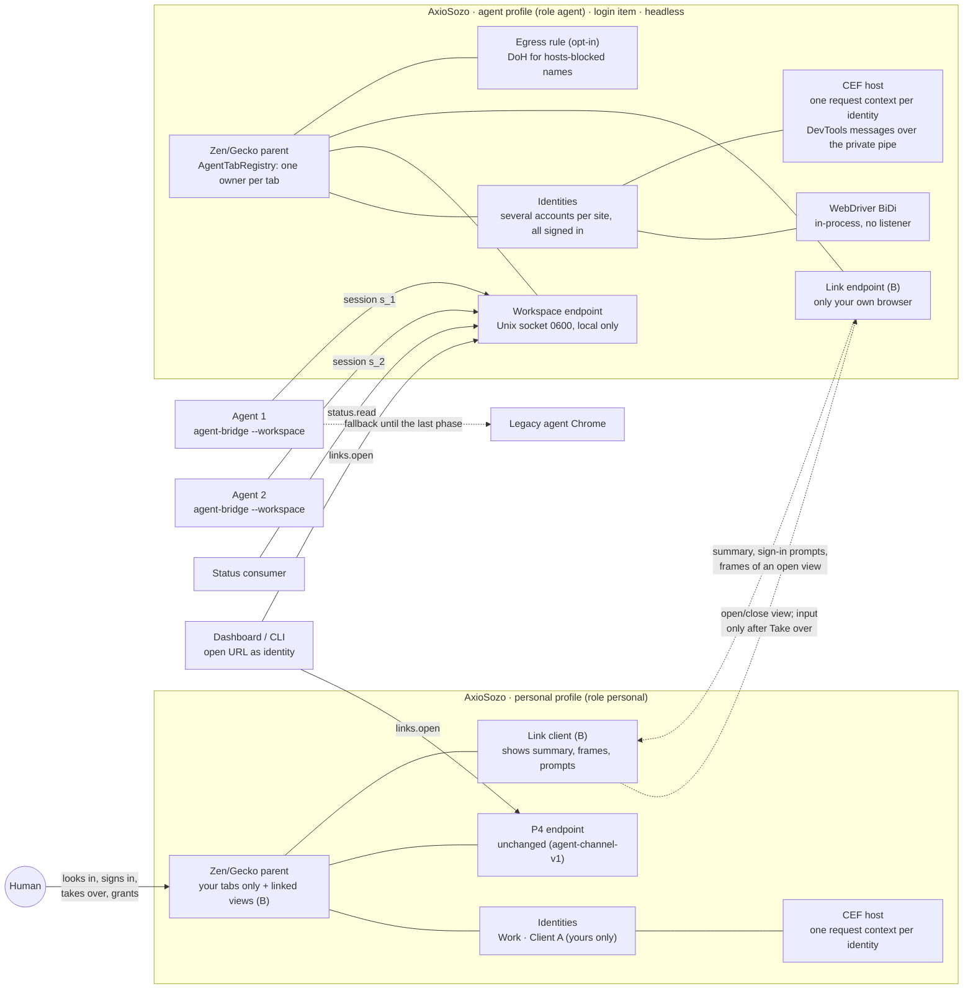

The same diagram as an image:
[`assets/agent-workspace/architecture.svg`](assets/agent-workspace/architecture.svg).

- **Two instances of one app.** The personal profile and the agent profile
  are two processes of the same AxioSozo/Zen build. Each has its own parent
  process, content processes, CEF host and Chromium profile. They share no
  profile directory, cookie, cache, password store, add-on or preference.
- **Agents connect only to the agent space.** Both instances run the same
  `AgentChannelService`, each on its own profile socket (`<profile>/.a/s`,
  agent-channel-v1 §1). The agent endpoint serves the workspace tools (§7.1)
  under the rules of §6. The personal endpoint keeps the P4 rules, unchanged,
  and gains nothing from this design.
- **The link joins the two windows, not the two profiles** (§3.11). The agent
  instance tells your browser which agents work, on which hosts, in which
  state, and about any open sign-in prompt (§5.4). That summary carries
  hosts, identity names, task titles and states: no URLs beyond the host, no
  page content and no cookies. When you open a linked view, the frames and
  accessibility tree of that one tab follow, until you close it. Your browser
  sends only view requests, and your input after an explicit *Take over*.
  Nothing from your profile is ever sent.
### 3.3 The agent profile (A1)

- **Created once from Settings.** about:axiosozo → Agents → *Set up the agent
  workspace* creates a new Gecko profile through the profile service. Its
  `axiosozo/profile-role.json` file says `{"role":"agent"}` and is written only
  by that privileged action. Prefs, pages and agents cannot create or change a
  role. A profile without the file is `personal`.
- **Why a profile and not only containers.** Containers separate cookies, but
  they share the password store, history, add-ons and network prefs (DoH is
  per profile), and the CEF host is per Zen profile. A1's requirement, that a
  session never lives in both browsers, needs the whole profile apart, and
  only a profile can carry its own egress rule (§3.5). Inside the profile,
  identities (§3.4) separate accounts from each other.
- **Logins come only from the human signing in** (§5.4). The agent profile
  turns password autofill on page load off (`signon.autofillForms=false`), so a
  saved login is never filled into a page an agent opened. The human can still
  fill one by hand.
- **No import, copy or sync.** No cookie, storage or password import from
  another profile or browser is offered. Firefox Sync's login and history
  engines are off in the agent profile, and Settings explains why. The same
  account may be signed in in both profiles, but only through two separate
  sign-ins, so the two sessions are separate. A session is never copied.

### 3.4 Identities: several accounts per site (R2)

An **identity** is one signed-in persona: a name and colour the human chose,
with its own cookies, storage and cache in both engines. Five accounts of one
web app are five identities, all signed in at once.

- **What an identity is underneath.**
  - Gecko: one contextual identity (a container, `userContextId`). Gecko
    already keys cookies, storage and cache by it.
  - Chromium: one CEF request context with its own `cache_path` under the
    profile's Chromium directory (`<session>/chromium/identities/<key>`).
    workstation-v1 §3 already requires one request context per Gecko
    container, with no fallback to a shared jar. This design builds that. A
    request context is created when the identity's first Chromium tab opens
    and released when its last one closes.
  - A record `{key, name, color, icon, sites, agents, aliases, last_used}` in
    `<profile>/axiosozo/identities.json` (`JsonStore`). Callers and agents use
    the `key` (`i_…`) or an alias, never the numeric `userContextId`. This is
    the same rule `ProjectContainers` follows ("no actor-facing method
    accepts an ID").
  - Project containers (P2) are identities that belong to a project. They
    show in the same list, and their routing stays as workstation-v1 §3
    defines it.
- **Identities are per profile.** The personal profile and the agent profile
  each have their own. If the same account is needed in both, the human signs
  in twice, and the two sessions are separate (A1).
- **Scratch identities.** In the agent space, an agent that asks for a clean
  identity gets a temporary one. It holds no sign-ins and is deleted, data
  included, when the agent's session ends. Scratch identities exist only in
  the agent space; the personal profile never gets one.
- **How an identity is chosen.** The first rule that applies wins:
  1. *Named in the call.* `new_page({url, identity})`, `links.open({url,
     identity})`, by key or alias. The caller must be allowed to use it
     (§6.5).
  2. *Opener.* A link or pop-up opened from a tab stays in that tab's
     identity. Gecko already does this, and the CEF side inherits the
     request context.
  3. *Link rule.* A remembered `{URL pattern → identity}` rule, from the
     chooser's *Remember* or a caller's mapping (§5.8).
  4. *Agent default.* The session's default identity, set by the human in the
     Agents panel. An agent may propose one in `hello`; it applies only if
     the agent may use that identity.
  5. *Site default.* "New tabs: Work" or "New tabs: Ask", per site.
  6. *Otherwise:* a site with one identity uses it. A site with several opens
     the chooser for a human (mock h) and returns `IDENTITY_REQUIRED
     {candidates}` to an agent, and nothing opens. A site with none uses the
     profile's default identity.
- **Never:** change the identity of a loaded tab (another identity means a new
  tab, as `ProjectAccountRuntime` already requires), guess from page content,
  or read an account name from a page. Identity names are labels the human
  typed.
- **How it shows.** A colour stripe on the tab (Firefox's container colours),
  an identity chip in the URL bar, the name in the tab tooltip, next to each
  tab in the Agents panel, and in every sign-in prompt.
- **Managing** (about:axiosozo → Identities, mock g). Identities are grouped by
  site and listed with their sign-in state and the agents using them. The
  page offers:
  - *New identity* and inline *Rename* and *Colour*.
  - An *Agents* switch per identity (off for new identities in the personal
    profile).
  - *Sign out*, which clears that identity's cookies and storage in both
    engines and keeps the identity.
  - *Remove…*, which asks for confirmation, then closes the identity's tabs,
    deletes its data in both engines and deletes its link rules. Agents
    using it get `IDENTITY_REMOVED` on their next call.
  - Aliases, the names callers use (§5.8).

  Each instance shows its own identities. The segmented control switches to
  the other instance's page, and no data crosses.

### 3.5 Per-profile egress rule (A2)

The loopback proxy and its root-installed policy are replaced by a setting of
the agent profile: **"Let agents reach sites blocked on this Mac"** (off by
default, shown only when the role is `agent`).

- **Gecko.** With the setting on, the agent profile writes stock prefs at
  startup: `network.trr.mode=3` (DoH only), `network.trr.uri` set to the chosen
  resolver, and `network.trr.exclude-etc-hosts=false`, so that names the hosts
  file blocks are resolved through DoH. Local names stay on the system
  resolver: `network.trr.excluded-domains` holds `localhost`, `local`, the mesh
  VPN suffix entered by the user and any other private suffix, and
  `network.trr.allow-rfc1918=false` keeps private answers out. Personal
  profiles never get these prefs.
- **Chromium (agent profile's CEF host).** The host starts with Chromium's
  secure DNS in `secure` mode and the same template, set on every identity's
  request context. Whether Chromium on macOS still applies the hosts file
  before secure DNS is **unverified**. If it does, the agent instance starts a
  profile-owned resolver child for its CEF host only: the same rule as today's
  proxy (system answer first, DoH only when the answer is a block), on a
  loopback port with a random token. Its pipe is the lease, as in
  `ProjectRunner`, so the child dies with the instance. The request contexts
  point at it. It is never a system-wide policy.
- **What stays the same.** The system hosts block is not touched. Other apps
  and the personal profile keep it. Only errors are logged, and no
  per-request log of names is kept.
- **Linked views respect the block.** A linked view (§3.11) shows pages the
  agent space loaded, so with this rule on it could show a blocked site
  inside your own window. By default it does not: for a tab whose host the
  Mac blocks, the linked view shows only the summary line (agent, host,
  state) and no frames. A separate Settings switch, *Show blocked sites in
  linked views*, off by default, changes that. Sign-in for such a site opens
  in the agent space's own window instead (§5.4).
- **Opt-in, scoped, visible.** The setting is per profile, needs a trusted
  click, and shows in the agent window's identity panel ("This profile uses DNS
  over HTTPS").

### 3.6 The agent endpoint and tab ownership (A3, A4, R1)

- **Off until Settings turns it on, local only.** As today, every process
  starts with the endpoint off, and only the explicit Settings action in a
  normal window enables it (agent-channel-v1 §1). The transport stays a Unix
  socket (mode 0600, directory 0700, no TCP listener). **The only change, for
  the `agent` role:** the trusted Settings action also records "enabled for
  this profile" in `profile-role.json`, so a crash restart or a login brings
  the endpoint back without a click. A saved pref alone still enables nothing,
  and personal profiles keep the exact per-process rule. Turning it off in
  Settings clears the record and closes every session. This is a change to
  agent-channel-v1 §1, owned by the integration lead (phase 3).
- **Sessions without a prompt in the agent profile.** In the personal profile
  every session needs *Allow for this session*. In the agent profile the human
  already chose to give the profile to agents, so a `hello` from
  `agent-bridge` in workspace mode is admitted at once and listed in the
  Agents panel (§5.1) with *Disconnect*. Settings offers *Ask before a new
  agent connects* (off by default). Limits rise from 8 to 16 connections; each
  session may own at most 24 tabs.
- **Every tab has one owner, in both profiles.** `AgentTabRegistry` gains an
  `owner` field: a session id `s_…`, `human`, or `system` (the sign-in probe
  and link lookup). `new_page` creates a tab owned by the caller. A pop-up
  inherits its opener's owner. Every read and every input checks `owner ===
  session` before anything else runs, and fails with `NOT_OWNER` otherwise.
  `list_pages` returns only the caller's tabs plus a count of tabs it cannot
  see. The owner field exists only in the agent space: the personal
  profile's tabs are all yours and carry no owner field.
- **Resuming.** The bridge receives a resume token in `welcome` and keeps it
  in memory. When a session's connection drops, its tabs become **parked** for
  10 minutes: still owned, but visible to no one. A reconnect with the token
  within that time takes them back. After that, parked tabs close unless the
  human adopts them in the Agents panel or in a linked view.
- **Human hand-over.** In the agent space, the human can give a human-owned
  tab to an agent, take one (§5.7, §3.11), or close any tab. Tabs of the
  personal profile are never handed over: *Send to agent space* (§3.1) opens
  the URL as a new agent-space tab instead. Agents can never give tabs to
  each other.

### 3.7 Headless by default, watch on demand (R3)

The browser belongs to the agents while they work: their tabs have no visible
view. A human who wants to see one attaches a view, and that view costs
rendering.

- **Headless means "not painted", not "not run".**
  - *Gecko.* An agent tab without a visible view is an inactive docshell.
    Nothing is painted or composited, and `requestAnimationFrame` is paused.
    Layout, script and network run normally. A snapshot reads the
    accessibility tree, which needs no painting. A screenshot paints one
    frame offscreen on request (`captureScreenshot`).
  - *Background throttling.* Firefox slows timers in background tabs, which
    would slow agents. Agent-owned tabs are exempt from background timeout
    throttling. Whether the pinned Gecko has a per-tab switch for that
    without a patch is an open question (§10).
  - *Chromium.* A CEF windowless target marked hidden produces no frames, and
    the host sends nothing to Zen's surface. `Page.captureScreenshot` renders
    on request; that this works for a hidden windowless target is to be
    verified (§10).
- **Attach a view (Watch).** There are two ways to watch, with the same
  rules:
  - *From your own window* (the usual way, once phase 14 lands): *View* in
    the Agents list opens a **linked view** (§3.11). The agent instance
    paints that tab and hands the frames to your browser; it needs no window
    of its own.
  - *In the agent space's own window* (phases 6 and 11, and the fallback):
    *Watch* in its Agents panel or tab menu brings that window forward with
    the tab selected. The instance becomes a regular app while one of its
    windows shows.

  Either way the tab becomes active and paints at the display's rate, and a
  Chromium tab streams frames to a Zen surface (engine-surface-v1).
- **The resource note.** While watching, the agent bar shows **LIVE** and the
  measured cost of that tab's processes: CPU share and memory, from the same
  per-process data about:processes uses, and the CEF host's process list for
  Chromium tabs. Nothing is estimated. If a value cannot be measured, the bar
  shows none.
- **Detach.** These all return the tab to headless:
  - *Stop watching*, or *Close view* on a linked view
  - closing or minimising the window that shows it (your window for a linked
    view, the agent window otherwise)
  - selecting another tab, so the view is no longer shown
  - the screen locking
  - 10 minutes without human activity

  Painting stops and the Chromium frame stream stops. The agent sees no
  difference: calls in flight go on, and nothing is lost or replayed.
- **What it does to performance.** Unwatched tabs cost no painting or
  compositing. Each watched tab costs its own rendering, so the Agents panel
  shows "watching N" and the footer counts them. The Agents panel's per-tab
  preview is a still screenshot taken on request, never a live stream.
  Watching never changes the agent's input path, so it never slows the agent
  beyond the shared CPU.
- **Watching is read-only.** Input is takeover (§5.7; in a linked view only
  through the explicit *Take over*, §3.11).

### 3.8 One tool surface over two engines

| Layer | Gecko tabs | Chromium tabs |
| --- | --- | --- |
| Transport into the engine | In-process WebDriver BiDi sessions without a listener, as `GeckoBiDiReadSession`/`AgentActionRuntime` build them today: RemoteAgent and Marionette stay off and no port opens | CEF's in-process DevTools message API (`SendDevToolsMessage` and a message observer) inside the host, reached through new cef-v1 messages `devtools.attach`/`devtools.send`/`devtools.event` on the existing authenticated stdin/stdout pipe. No debugging port, no WebSocket |
| Identity | `userContextId` of the tab (`browsingContext.create` with a user context) | The identity's request context, chosen when the target is created |
| Snapshot (`take_snapshot`) | The Gecko accessibility tree of the tab's document, read in the parent, with stable `uid`s per node and document | The CEF accessibility tree that `engine-accessibility.md` already streams to Zen, or `Accessibility.getFullAXTree` |
| Input | BiDi `input.performActions`, `input.setFiles` | CDP `Input.dispatch*`, `DOM.setFileInputFiles` |
| Script | BiDi `script.callFunction` in a sandbox realm | CDP `Runtime.callFunctionOn` in an isolated world |
| Console and network | `ConsoleErrorsService` (extended to every level); BiDi `network.*` events | CDP `Runtime`/`Log`/`Network` events |
| Screenshot | BiDi `browsingContext.captureScreenshot` (`AgentCaptureRuntime`, today behind a literal `false`) | CDP `Page.captureScreenshot` |
| Only one engine has it | — | performance trace and insights, audit, heap snapshot (CDP domains) |

The browser filters both paths the same way before anything is dispatched:

- the owner check (§3.6)
- the takeover state (§5.7)
- the credential rule (§6.1)
- action grants (§6.2)
- identity permission (§6.5)
- private and sensitive hosts (`isSensitiveHost`)
- the bounds already in `AgentChannelCore` (`CHANNEL_LIMITS`)

The CEF host accepts only an allowlist of DevTools methods per attached
target, keyed by the browser-issued target identity and generation (cef-v1).
A tab that switches engine keeps its `tab_id`, owner and identity. A call in
flight during the switch fails with `UNAVAILABLE` and is never replayed.

### 3.9 Lifecycle: always available (A3)

- **Login item.** Settings registers the agent instance as a login item of the
  app, so it is visible in the system's login items. It starts the app with
  the agent profile and without a window, and it restarts after a crash. On
  macOS the instance stays an accessory app (no Dock icon) until it shows a
  window of its own (the agent window or its Agents panel). Linked views in
  your window need no agent window (§3.11).
- **Quitting** the agent instance from its menu or the Agents panel stops it
  until the next login or *Start agent workspace*. Agents then get the
  fallback of §8.
- **Shutdown** follows the existing rules. The endpoint and its sessions close
  first. Owned children (CEF host, resolver child) get their pipes closed.
  Scratch identities are deleted. Only this instance's process groups are
  touched.

### 3.10 Two Macs (A9) and observability (A10)

- Each Mac sets up its own agent profile and identities and signs in on its
  own. Nothing in this design moves cookies or sessions between Macs.
- Metrics: one record per call `{at, session, method, engine, ms, code}` in a
  RAM ring of 2,048 entries. With *Share tool metrics* on, records are
  appended to `axiosozo/agent-metrics.jsonl` in the agent profile, rotated at
  1 MiB. Nothing in it names a URL, an argument, an identity or page content.

### 3.11 The link: your window into the agent space (B, R1, R3)

Option B is a connection, not a second place for agent tabs. Your browser
shows what the agent space is doing, and opens agent tabs as live views,
while every page keeps running in the agent space.

- **What the link is.** A private channel between your browser (the personal
  instance) and the agent instance, separate from the agents' endpoint.
  - The agent instance listens on its own link socket inside the agent
    profile (mode 0600, directory 0700, no TCP listener), only while the
    agent workspace is on.
  - It accepts exactly one kind of peer: the personal instance of the same
    app, run by the same user. The agent instance checks the peer's user id
    and, on macOS, that the peer's code signature matches its own (from the
    socket's audit token). Agents, `agent-bridge`, pages and other processes
    are refused.
  - Your browser connects when Settings → Agents → *Show the agent space in
    this window* is on. It is on once you set up the agent workspace, and
    turning it off removes the Agents entry and every linked view.
  - The message format is a new contract (proposed name `agent-link-v1`),
    owned by the integration lead (phase 13).
- **What crosses, and when.**

  | Direction | What | When |
  | --- | --- | --- |
  | agent space → your window | The summary: agents, task titles, states, per tab the host and identity name, the current action as a label the chrome writes ("Typing into Search"), open sign-in and grant requests | While connected |
  | agent space → your window | A still preview of one tab | On request, when you hover it in the Agents list |
  | agent space → your window | Frames of one tab (IOSurface handles over Mach, as engine-surface-v1 delivers them), its accessibility tree, its URL and title, and the measured cost | Only while that linked view is open and shown |
  | your window → agent space | Open view, close view, *Take over*, *Give back*, *Sign in*, *Later*, grant answers, *Send to agent space* (one URL) | When you click |
  | your window → agent space | Keyboard, mouse, wheel, touch and paste events for one tab | Only while you hold that tab after *Take over* |

  Never in either direction: cookies, storage, cache, passwords, history,
  session data, identities, add-on data or preferences.
- **What a linked view is in your window.** It is not a tab of your profile.
  - It sits under its own *Agent space · linked* heading at the end of your
    sidebar, framed in the agent-space colour. The URL bar shows the
    *Agent space* chip, the host and the identity chip (mock i).
  - It writes no history entry, session-restore entry, cache entry or cookie
    into your profile. It can't be moved among your tabs, pinned or put in a
    folder. *Copy link* copies only the URL, and opening that URL yourself
    opens an ordinary tab of your own profile with your own sign-ins.
  - Your extensions, password manager, autofill, content blockers and dev
    tools don't apply to it, because the page isn't loaded in your profile.
    Those of the agent space do.
  - When your browser quits, its linked views are gone. The agent tabs are
    not.
- **Read-only by default.** While an agent drives, no input reaches the page.
  Clicks, keys, wheel and drops stop in your browser, and a click shows a
  short hint: "Read-only. Take over to use this page." The view scales to
  fit and follows the agent's viewport. Screen readers read it through the
  forwarded accessibility tree, the same pattern `engine-accessibility.md`
  uses for Chromium tabs, so the view is never a blank picture to assistive
  technology.
- **Rendering costs only while you look** (key decision 4). The agent
  instance paints the tab only while its linked view is open and shown
  (§3.7). Closing the view, switching to another tab, minimising your window,
  locking the screen or 10 minutes without activity return the tab to
  headless. Frames cross as surface handles, not pixel copies. The view's bar
  shows **LIVE**, *Read-only* and the measured cost, and the Agents entry
  says "viewing N".
- **Taking over.** Only an explicit action takes over: the *Take over* button
  or its menu item, never a stray click or key in the view. The effect is
  the one of §5.7, in the agent space:
  - the tab's owner becomes `human`, with the agent remembered
  - the agent's pending input is cancelled, and every further call on the
    tab gets `HUMAN_IN_CONTROL`, reads included
  - your input travels over the link and is delivered there as native input,
    so the page sees an ordinary user
  - **cookies stay in the agent space.** What the page stores while you hold
    it, including a sign-in or an accepted cookie banner, lands in that tab's
    agent-space identity. Nothing is written to your profile, and your
    password manager neither fills nor saves there.
- **Handing back.** *Give back* returns the tab to the remembered agent, and
  the view turns read-only again. The tab also goes back by itself 15
  minutes after your last input, never while a password or one-time-code
  field has focus (§5.7). *Close view* while you hold the tab stops the
  rendering; the tab stays yours, headless, until you give it back from the
  Agents list or the 15 minutes pass. The agent then works with whatever
  state the page and identity have, such as the sign-in you just did.
- **When the link breaks.** If the agent instance stops, linked views show
  "The agent space stopped" with *Start agent space*, and your own tabs are
  not affected. If your browser quits, the agent space keeps working; tabs
  you held through the link go back to their agents as with *Give back*,
  except sign-in tabs, whose requests stay open (§5.4).
- **Sites the Mac blocks** are not shown in linked views by default (§3.5).
- **Fallback.** If a linked view cannot be shown (phase 14 not done, or Gecko
  frames cannot yet cross instances, §10), *View* brings the agent space's own
  window forward with that tab, as in §3.7. Ownership, identities and
  takeover work the same.

## 4. What the human sees at a glance

| Place | What it shows |
| --- | --- |
| Personal window, sidebar footer and toolbar | An **Agents** entry when agents work: a ring while they work, amber with a count when one needs you (sign-in, grant), red when the endpoint or the link failed. A small agent-space mark with the same count sits in the toolbar, for compact mode. Click → the agent-space list: each agent, its task, host, identity and current action, with *View* or *Sign in* (mock f) |
| Personal window, *Agent space · linked* (B) | Linked views you opened, below your own tabs and framed in the agent-space colour: **LIVE**, *Read-only*, the agent and its action, the cost, *Close view*, *Take over*; after takeover *Give back* (mocks i, j). Your own tabs never carry agent marks |
| Personal window, bottom right | Non-blocking sign-in prompts; *Sign in* opens a linked sign-in view (mock b) |
| Agent window, sidebar | Tabs grouped **by owner**: one section per agent session (agent name, task title, state), then *You* (human-owned tabs), then *Parked*. Identity stripes on every tab |
| Agent window, Agents panel | Every session: agent, task, tabs, last call and its result, *Watch*, *Disconnect*; the endpoint state; the grants in force |
| about:axiosozo → Agents (Settings) | Workspace on/off, endpoint on/off, the egress setting, sign-in status per site and identity, grants and their history, metrics sharing |
| about:axiosozo → Identities | Identities per site: state, agents using them, the *Agents* switch, rename, colour, sign out, remove, aliases |

## 5. Native UI: the flows

All flows use Zen's own material: the sidebar, tab folders, the notification
bar (`notificationbox`), the doorhanger and toast (`AxioSozoToast`), sheets
and menus, and the Lab kit card (`lab.css`). Text is set as text, never
markup. Each mock comes in light and dark.

### 5.1 (a) Which tabs agents own in the agent workspace

- The agent window's sidebar groups tabs by owner. Each agent section shows:
  - the agent's name and icon
  - the task title it gave in `hello` (or "Untitled task")
  - its state: working (a slow ring, as in the Lab presence experiment),
    waiting for you (amber), idle, or paused by you
- A tab row carries the identity stripe and a small owner badge. A tab an
  agent is acting on right now shows the current action in its tooltip
  ("Typing into Search").
- The **Agents panel** (a Lab-kit card over the content, top right) lists every
  session:
  - the agent and its task
  - how many tabs it owns
  - its last call and the result code, and how long ago it ran
  - *Watch* (§3.7) and *Disconnect*, which closes the session and parks its
    tabs

  The header shows the endpoint state ("On · this Mac only · 2 agents") and
  the egress setting when it is on.
- This is the agent space's own window, which appears only when you ask for
  it (*Open agent window*). In your personal window, the **Agents** entry
  shows the same summary through the link and opens the agent-space list
  (§5.2).

### 5.2 The linked view: from your window into the agent space (option B, R1, R3)

Three moments: you see what agents are doing, you open one tab live, and you
take over. The rules behind them are in §3.11.

**(f) The indicator in your window.**

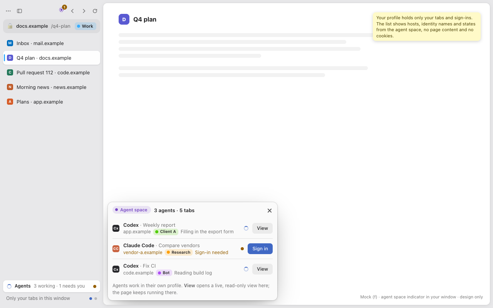
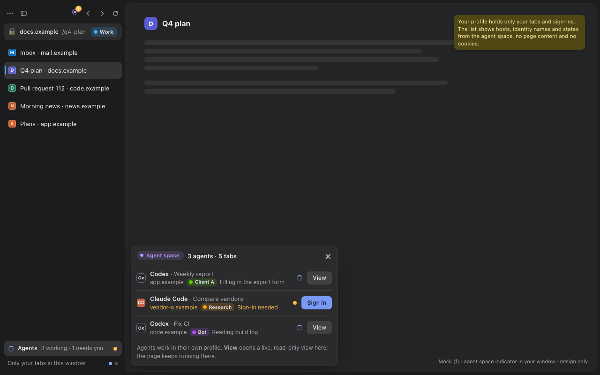

- Your window holds only your tabs. The **Agents** entry at the foot of the
  sidebar, and its mark in the toolbar, show that the agent space is busy: a
  ring while agents work, amber with a count when one needs you.
- Clicking it opens the **agent-space list**, a Lab-kit card anchored to the
  entry. One row per agent session:
  - the agent's icon, name and task title
  - the host and identity of the tab it is working on, and its current
    action
  - its state, and *View* (opens the linked view) or, when it waits for you,
    *Sign in* or *Review grant*

  The header names the place ("Agent space · 3 agents · 5 tabs") and offers
  *Open agent window*. The list carries hosts, identity names and states,
  never page content or cookies.

**(i) A live, read-only view open in your window.**

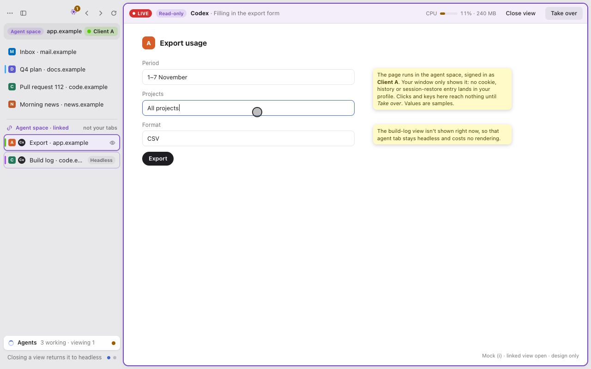
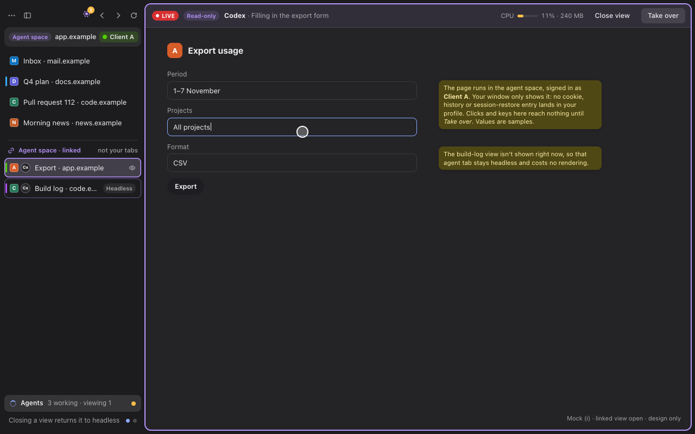

- *View* adds an entry under *Agent space · linked* at the end of your
  sidebar and shows the agent's tab in your content area. The frame around
  it, the entry's outline and the URL bar's *Agent space* chip use the agent
  profile's colour, so it never looks like one of your tabs. The identity
  chip says *as whom* the page runs.
- The view's bar shows **LIVE**, *Read-only*, the agent and its action, the
  measured cost of that tab's processes in the agent space, *Close view* and
  *Take over*. The agent's pointer shows as a ring drawn by the chrome.
- A second linked view that is not shown stays listed but headless, marked
  *Headless*. Closing a view removes its entry and returns the tab to
  headless. The values in the mock are samples.

**(j) Taking over, and handing back.**

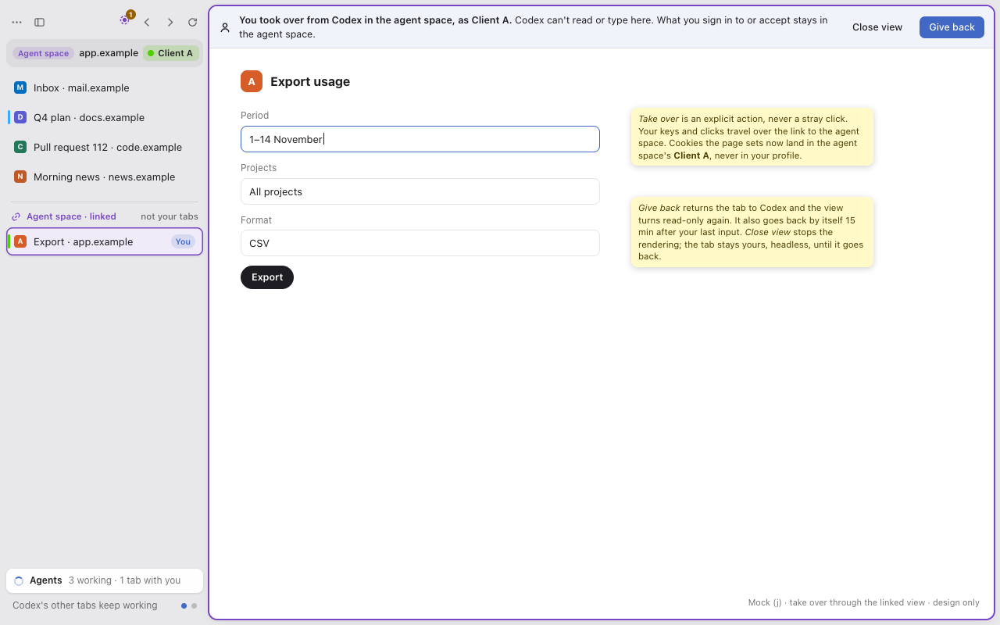
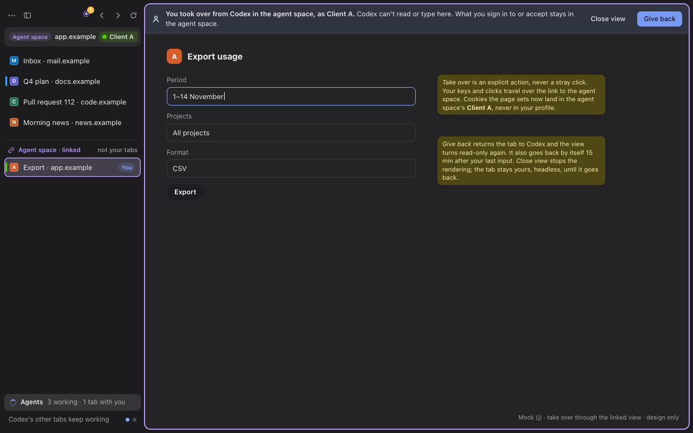

- *Take over* is the only way in. The entry's badge turns to *You*, and a
  notification bar says "You took over from Codex in the agent space, as
  Client A. Codex can't read or type here. What you sign in to or accept
  stays in the agent space." with *Close view* and *Give back*.
- You use the page normally. Your input goes over the link; cookies and
  storage the page sets go into the agent space's Client A identity, never
  into your profile.
- *Give back* returns the tab to the agent and the view to read-only. The
  15-minute return of §5.7 applies too. The agent's other tabs and every
  other agent keep working throughout.

### 5.3 Identities: choose, show, manage (R2)

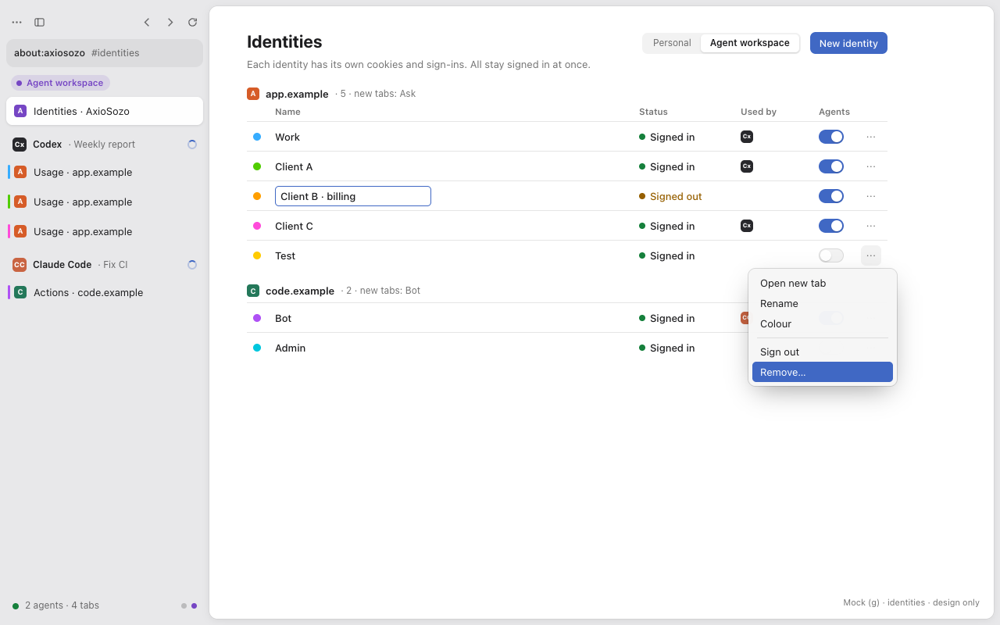
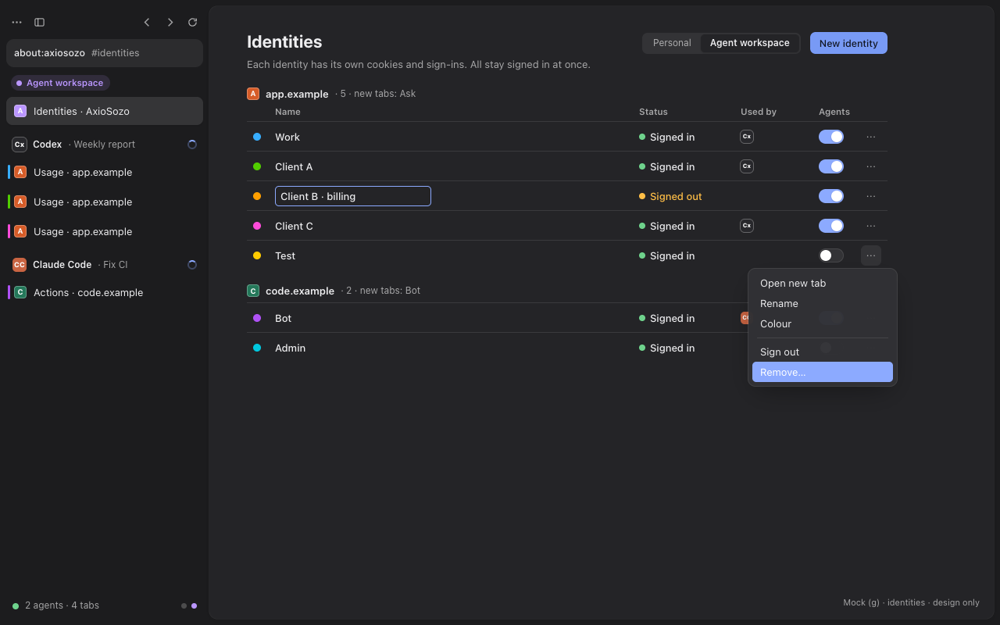

- **One row per identity, grouped by site.** Each row shows the colour, the
  name, the sign-in state, the agents using it now, the *Agents* switch, and a
  menu: *Open new tab*, *Rename*, *Colour*, *Sign out*, *Remove…*. Rename
  edits in place.
- **Per site:** "New tabs: Ask" or a default identity (§3.4 rule 5).
- **New tab in an identity:** long-press or right-click the new-tab button
  for the identity menu, as Firefox does for containers.
- **Remove** asks for confirmation in a sheet. Its consequences are listed
  in §3.4.

### 5.4 (b) Sign-in needed or session expired (R4)

**How it starts.**

- *An agent asks.* `request_human_login({site, identity?, reason})`. The
  identity defaults to the one of the agent's tab on that site. The call
  returns at once with `{request_id, state:"waiting"}`.
- *The browser detects it mid-task.* Any of these counts:
  - a navigation in an agent tab lands on the site's login URL
  - the site's signed-out marker appears
  - a top-level response is 401
  - the probe (§5.5) finds the identity signed out

  The browser marks that site and identity *Signed out* and remembers the
  URL the tab was on before the redirect (the return URL). The agent's
  current call returns `LOGIN_REQUIRED {site, identity, request_id}`. The
  tab stays usable for reading, but the credential rule (§6.1) refuses any
  typing into the login form.

**One request per site and identity.** The key is (profile, identity, site).
A second agent hitting the same wall joins the open request ("2 agents
waiting"). Two identities of the same site are two requests.

**The prompt does not block.**

- A Lab-kit card appears at the bottom right of the personal window. It
  arrives through the link (§3.11), from the agent space that raised it. It
  takes no focus and has no modal layer. It shows:
  - the waiting agents' icons
  - *Session expired* or *Sign-in needed*
  - the site and the identity chip
  - how many agents wait
  - *Later* and *Sign in*
- If no personal window is in front, one system notification with *Sign in*
  appears instead.
- The Agents entry turns amber with the count.

**Signing in.**

- *Sign in* opens a **human-owned** tab **in the agent space**, in the
  identity that needs it, at the site's login URL (or the URL the agent hit).
  That tab shows in your own window as a linked view (§3.11), under *Agent
  space · linked*, already yours: no *Take over* is needed, because the
  browser created it for you.
- **The sign-in happens in the agent space's identity, never in your
  profile.** The session cookie lands in that identity (Client B in the
  mock). Your profile gets no cookie, history entry or saved password from
  it.
- A notification bar says "Sign in as Client B in the agent space. Agents
  can't see this tab. The sign-in stays there, not in your profile. 2
  waiting." with *Done* and *Cancel*.
- The human signs in however they like: typing, a passkey, two-factor, or a
  password from their own password app. The personal profile's password
  manager does not fill or save here, since the page isn't in that profile.
  No agent can list, read, screenshot or drive this tab.
- Before phase 15, and for sites the Mac blocks (§3.5), the same tab opens
  in the agent space's own window instead. The rules are the same.

**Resuming.**

- The site's signed-in marker in that tab, or *Done*, sets the identity to
  *Signed in* and closes the tab. If the human browsed elsewhere in it, the
  tab stays as theirs.
- Every waiting agent gets `{state:"signed_in"}`.
- Waiting tabs that sit on the login page go back to their return URL. That
  is one navigation, never a replay of an earlier action.
- Nothing restarts, and no other agent was interrupted.

**When the human ignores it.**

- *Later* hides the card. The request stays open in the Agents panel (amber),
  and no new card appears for that key for 1 hour. Waiting agents get
  `{state:"deferred", retry_after}`.
- An unanswered card stays until dismissed. A system notification fires at
  most once per key per hour and three times per key per day.
- Agents never hang. `wait_for_login({request_id, timeout})` waits 5 minutes
  by default (at most 60) and then returns `{state:"waiting"}`. The agent can
  work elsewhere or tell its own user that it is blocked on a sign-in.
- *Cancel* or the card's close button resolves the request as
  `{state:"declined"}`. Detections of the same key in the next hour only
  update the amber entry and raise no card.
- After 24 hours an open request closes as `{state:"expired"}`. A new
  detection opens a new one.

### 5.5 (c) Sign-in status per site and identity

- about:axiosozo → Agents → **Sign-ins** has one row per site and identity:
  - the state: *Signed in*, *Signed out* (with how many agents wait),
    *Checking…* or *Unknown*
  - when it was last checked
  - *Sign in* (the flow of §5.4) or *Check*

  *Add site…* takes the four fields of a probe. Rows show no cookie names or
  values.
- **The probe.** Every 4 hours, and on *Check*, a `system`-owned background
  tab in the agent profile loads each site's probe URL in each of that site's
  identities, one at a time. It decides:
  - the signed-out marker means signed out
  - the signed-in marker means signed in
  - anything else (an error, a timeout, neither marker) means *unknown*,
    never signed in

  The probe keeps sessions warm as today, and it never runs while that
  identity's sign-in tab is open.
- **Passive updates** come from the detections of §5.4.
- **Notification.** A change to *Signed out* with no agent waiting raises at
  most one notification per site and identity per day. With agents waiting,
  §5.4 applies instead.
- The same page holds **Action grants** (§6.2) and the endpoint and egress
  switches, so the Agents settings page is the one place for agent safety.

### 5.6 Watch live (R3)

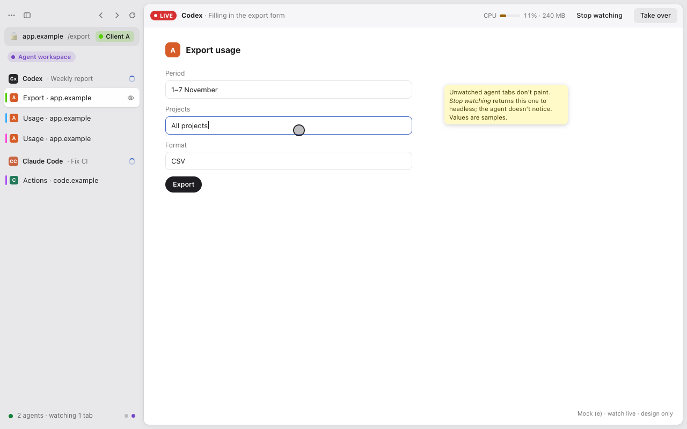
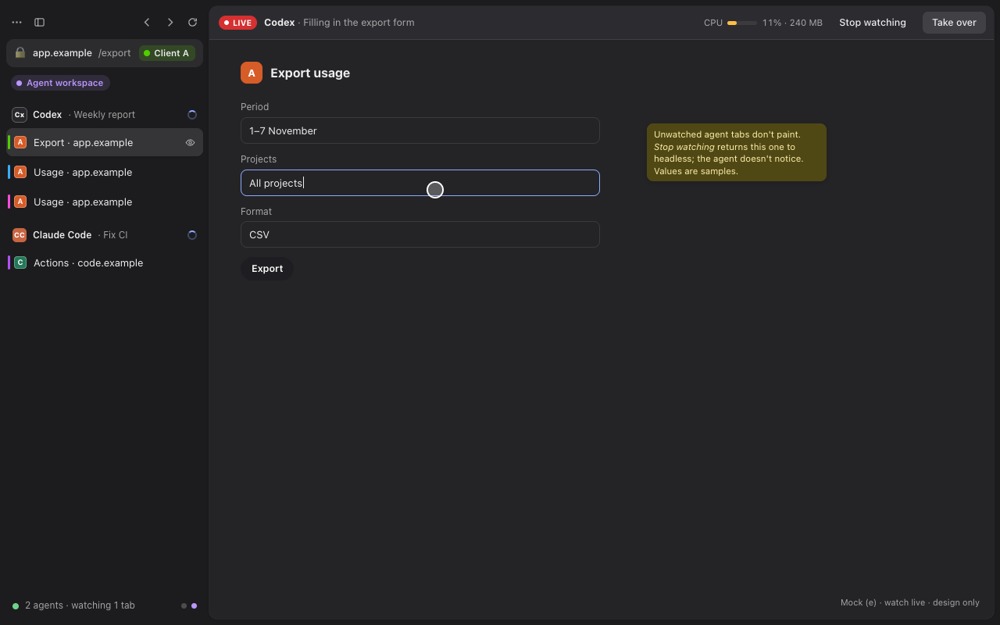

This mock shows watching in the agent space's own window. Watching from your
own window is the linked view (§5.2, mock i): the same bar and the same
rules, plus *Read-only* and the agent-space frame.

- The watched tab shows an eye in the sidebar. The agent bar on the page
  shows:
  - **LIVE**
  - the agent and its current action
  - the measured cost (§3.7)
  - *Stop watching* and *Take over*
- The agent's pointer shows as a ring where it clicks, so the human can follow
  input. The ring is drawn by the chrome, never by the page.
- The values in the mock are samples. The real bar shows measured values or
  none.

### 5.7 (d) Takeover: a human types into an agent's tab

This mock shows takeover in the agent space's own window. Through a linked
view in your own window (§5.2, mock j) the effect is the same, but only the
explicit *Take over* triggers it: input in a read-only linked view reaches
nothing and takes nothing over (§3.11).

- **Trigger.** In the agent space's own window: native human input in the
  content of an agent-owned tab, or the *Take over* button. Input means keyboard, click, wheel or touch, including
  input that arrives through screen sharing or a shared keyboard.
  - *Gecko* tells human input from automation in the parent: the BiDi input
    dispatcher marks its own events, while human events arrive from the
    widget. This is to be checked against the pinned Gecko in phase 6.
  - *Chromium:* `CEFPresenter` forwards OS events itself, so it knows which
    input is human.
  - These are not a takeover: hovering, scrolling the sidebar, or focusing
    the window.
- **The first input is not delivered.** The event that triggers the takeover
  goes to the browser, not the page. A stray click never presses a button the
  agent was about to press, and keys never interleave with the agent's
  typing. From the next event on, the human uses the tab normally.
- **Effect, at once and per tab.**
  - The tab's owner becomes `human`, with the previous agent remembered.
  - That agent's pending input on the tab is cancelled. An effect already
    dispatched may finish, and nothing is replayed (agent-channel-v1 §4.2).
  - Every further call on the tab, reads included, gets `HUMAN_IN_CONTROL`
    with `retry_after`. Reads are paused too, so an agent never sees what the
    human types.
  - Other tabs and other agents are not affected.
- **What the human sees.** A notification bar: "You took over from Codex. It
  can't read or type here. Its other tabs keep working." with *Give back*.
  The tab's badge changes to *You*.
- **Ending it.**
  - *Give back* returns the tab to the agent.
  - The tab also goes back by itself 15 minutes after the last human input
    (today's pause limit), but never while a password or one-time-code field
    has focus.
  - Closing the tab ends it too. Closing a linked view does not close the
    tab; it only stops the rendering (§3.11).
  - A tab returned with a different document (the human navigated) gets a
    new document id, so the agent's old `uid`s are stale and it must
    snapshot again.

### 5.8 Account-aware links (R5)

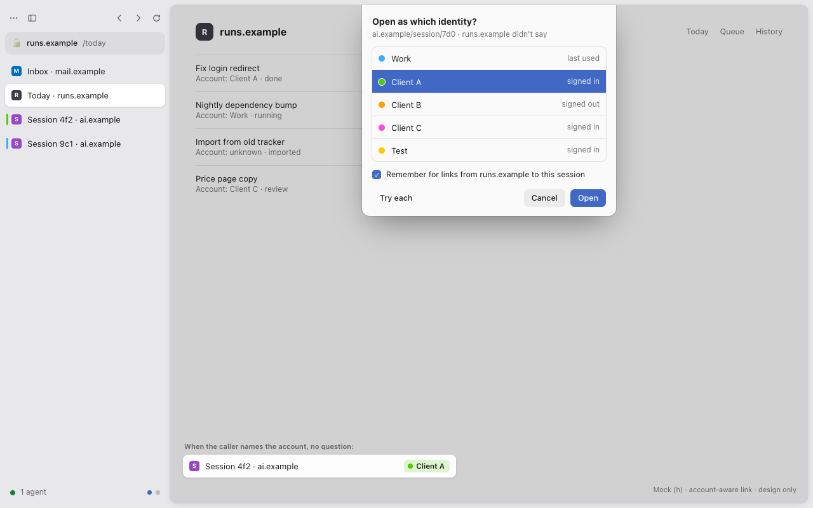
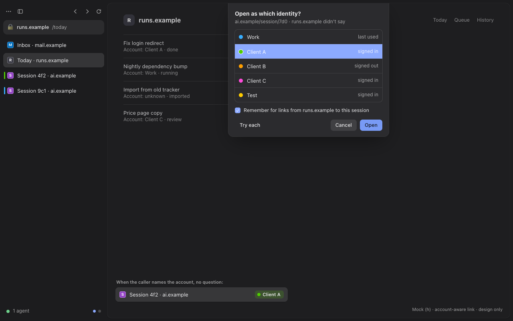

A link to a session in a web app, for example an AI coding session that only
one of several accounts of that service can see, must open as the account
that owns it. Nobody signs out and back in.

**How the owning identity is known**, in this order:

1. **The caller says it.** The caller passes `identity` (a key or an alias)
   with the URL. A caller that started the session usually knows which
   account it used. An **alias** is the caller's own name for an account,
   attached by the human to one identity. The human attaches it in Settings →
   Identities, or the first time a caller uses an unknown alias, in a small
   sheet: "Which identity is *client-a* for runs.example?". The answer is
   remembered.
2. **A mapping the caller provides.** A caller may register URL rules once,
   such as "everything under this workspace path belongs to alias X"
   (`links.map({pattern, alias})`). The human confirms them, and they are
   stored as link rules (§3.4 rule 3).
3. **Lookup, only when allowed.** *Try each* loads the URL in a hidden
   `system` tab in each signed-in identity of that site, one at a time. It
   takes the first one that does not show the site's no-access marker (an
   optional fifth probe field), stops there and remembers the rule. Lookup
   is off by default and allowed per site, because it sends a request as
   each account.
4. **Fallback: ask.** If nothing matches, a sheet lists the site's identities
   (last used first, with their sign-in state) and offers *Remember for links
   from this caller to this path*, *Try each* (only where lookup is
   allowed), *Cancel* and *Open*.
   - An agent caller gets `IDENTITY_REQUIRED {candidates}` instead.
   - The link never opens silently in the default identity.
   - If the owning identity is signed out, the tab opens and §5.4 starts
     for that identity.

The API callers use ("open this URL as identity X") is in §7.4.

## 6. Agent-safety rules as browser behaviour

These rules apply wherever an agent owns a tab, and that is only ever the
agent profile. The personal profile holds no agent-owned tab; it keeps every
P4 rule of agent-channel-v1 §4 unchanged. The link of §3.11 is not an agent
endpoint and gives agents no access to anything.

### 6.1 Agents never enter credentials

- `fill`, `fill_form`, `type_text`, `press_key` and `upload_file` are refused
  with `CREDENTIALS_HUMAN_ONLY` when the target, or the focused element for
  key input, is any of these:
  - a password field
  - a field with `autocomplete` `current-password`, `new-password` or
    `one-time-code`
  - a field Gecko's login-form detection marks as a username or password
    field
  - a Chromium node exposed as a secure text field (the engine-accessibility
    tree)

  The browser then raises §5.4 for that site and identity.
- `click` on the submit control of a form that contains a password field is
  refused the same way. So are `handle_dialog` with text for an HTTP
  authentication prompt, and any WebAuthn or passkey prompt, which only a
  human can answer.
- A saved login is never filled on load (§3.3). No tool returns cookie values
  or authentication headers: network listings redact `Cookie`, `Set-Cookie`,
  `Authorization` and `Proxy-Authorization`. No cookie-store tool exists.
- Limit, stated plainly: `evaluate_script` runs in a sandbox realm, and that
  realm can still read cookies a page left readable to its own scripts. It
  cannot read `HttpOnly` session cookies. Sites in a sensitive category
  (`isSensitiveHost`) refuse `evaluate_script` entirely.

### 6.2 Posting, reacting, following and messaging need a human grant

- **Classes:**
  - `post`: publish, reply, comment, repost
  - `react`: like, upvote, reaction
  - `follow`: follow, connect, subscribe
  - `message`: direct message, chat, mail send
- **Grant.** A grant is `{session, site, identity, class, count, expires}`
  and comes only from a trusted click in browser UI.
  - An agent asks with `request_grant({site, class, count, reason})`. This
    shows a doorhanger in the agent window and a card in the personal one:
    "Codex wants to **post** on social.example as **Brand**, **once**: Reply
    to a launch thread." with *Allow* and *Deny*.
  - The human can also grant ahead of time in Settings ("Codex may post on
    social.example as Brand 3 times in the next hour").
  - Each grant is used up per action, ends with its session, and can be
    revoked at once.
- **Enforcement, two layers.**
  1. *Before dispatch.* A bundled, editable `action-rules.json` lists, per
     guarded site and class, the controls and form targets that perform it:
     by role and accessible name, by form action, or by request URL pattern.
     A `click`, `press_key` (Enter) or form submission whose target matches a
     class without a live grant fails with `GRANT_REQUIRED {site, class}`, and
     nothing is dispatched.
  2. *At the network.* A non-GET request to a guarded site's first-party
     origins is held when it follows an agent action in that tab: input,
     `evaluate_script` or navigation, within 5 seconds. Gecko catches it in
     `http-on-modify-request`, Chromium in the host's resource request
     handler, per identity's request context.
     - If it matches a class, it needs that class's grant.
     - If it matches a known harmless write (an analytics beacon, a draft
       autosave), it passes.
     - **Otherwise it is held as `post`**, the strictest class, and the human
       can allow it once from the doorhanger. Fail closed: an unknown write
       on a guarded site never goes out unseen.
- **Not guarded:** sites without rules. This design does not claim that the
  browser recognises every social action on every site. It guards the sites
  the human lists. Adding a site is one Settings action, and an unknown site
  counts as unguarded only until it is added.

### 6.3 Agents read and drive only their own tabs

Owner checks happen in the parent before any engine call (§3.6). `NOT_OWNER`
reveals nothing about the other tab, not even whether it exists. These tabs
are never listed to an agent:

- human-owned tabs in the agent space, including tabs you took over through
  a linked view
- sign-in tabs
- the probe's and lookup's `system` tabs

`list_pages` counts them only as "tabs you can't see: N". The personal
profile's tabs are not in the agent space at all, so an agent there cannot
even count them. Whether a linked view is open is invisible to the agent:
watching changes nothing it can observe (§3.7).

### 6.4 The endpoint stays off until Settings, and stays on this Mac

- Default off, and only a trusted Settings click enables it (§3.6). No pref,
  environment variable, page or agent can turn it on.
- It is local only, and stricter than a loopback port: a Unix socket that
  only the same user can open. There is no TCP listener, no debugging port
  and no WebSocket.
- The fallback resolver child of §3.5 listens on loopback for the CEF host
  only, with a random token, and serves no agent.
- The workspace tools exist only in a profile whose role is `agent`. The
  personal endpoint serves P4 only, unchanged.
- The link socket of §3.11 is not an agent endpoint. It lives in the agent
  profile with the same 0600/0700 rules, has no TCP listener, and accepts
  only the personal instance of the same signed app and user. A process that
  fails that check gets nothing, not even the summary.

### 6.5 Identities agents may use

- An agent may use the agent space's identities whose *Agents* switch is on,
  plus its own scratch identities. It can never use an identity of the
  personal profile, because those don't exist in the agent space.
  - Any other identity named in a call fails with `IDENTITY_NOT_ALLOWED`.
  - `list_identities` shows only the allowed ones, with key, name, sites
    and sign-in state.
- `links.open` callers (§7.4) are registered once by a human click ("Allow
  runs.example to open links as your identities"), per caller and revocable.
  A tab opened this way is owned by the human. The caller learns only
  `opened`, `chooser` or `refused`, and never anything about the page.
- A web page can never choose an identity by itself. The in-page form of §7.4
  works only on origins the human granted, and only for aliases that already
  exist.
- Removing an identity deletes its data in both engines (§3.4). No identity
  data is exported.

## 7. What consumers get

### 7.1 MCP server, equivalent to the DevTools MCP server (A4): drop-in

The workspace mode of `packages/agent-bridge` (`--workspace`) offers **the same
tool names and the same arguments** as the DevTools MCP server version that
agents use today (1.12, with the options the current setup passes). An agent's
MCP entry changes its command, and nothing in its prompts or skills changes.
Differences in behaviour are the safety rules themselves:

- other agents' pages are invisible
- credentials are refused
- gated actions ask for a grant
- sites with several identities may answer `IDENTITY_REQUIRED`

| Tool (same name) | Gecko tab | Chromium tab | Status |
| --- | --- | --- | --- |
| `list_pages` | registry, own tabs only, with identity | same | extend (`tabs.list`) |
| `new_page` | BiDi `browsingContext.create` in the chosen identity (§3.4), owned by the caller; engine per site preference (`EnginePreference`) or optional `engine`; optional `identity` | Zen tab in Chromium (`EngineTabs`) in the identity's request context | extend (`tabs.open`, gated `false` today) |
| `select_page` | bridge-side current page; `bringToFront` never steals focus from the human | same | new |
| `close_page` | own tabs only | same | new |
| `navigate_page` (url, back, forward, reload, `initScript`) | BiDi `navigate`/`traverseHistory`/`reload`, `script.addPreloadScript`; returns `still_loading` after the timeout | CDP `Page.navigate`, `Page.addScriptToEvaluateOnNewDocument` | extend (`tabs.navigate`) |
| `take_snapshot` | Gecko accessibility tree with `uid`s | CEF accessibility tree | new |
| `wait_for` | text match over the snapshot | same | new |
| `click`, `hover`, `drag` | BiDi `input.performActions` | CDP `Input.dispatchMouseEvent` | extend (`page.click`) |
| `fill`, `fill_form`, `type_text`, `press_key` | BiDi input + §6.1 checks | CDP `Input.insertText`/`dispatchKeyEvent` + §6.1 | extend (`page.type`) |
| `upload_file` | BiDi `input.setFiles`; only files under the workspace's uploads folder | CDP `DOM.setFileInputFiles`, same folder rule | new |
| `handle_dialog` | BiDi `browsingContext.handleUserPrompt` (never for HTTP authentication) | CDP `Page.handleJavaScriptDialog` | new |
| `take_screenshot` | BiDi `captureScreenshot` (`AgentCaptureRuntime`), works headless | CDP `Page.captureScreenshot` | extend (`tabs.screenshot`) |
| `evaluate_script` | BiDi `script.callFunction`, sandbox realm | CDP `Runtime.callFunctionOn`, isolated world | new |
| `list_console_messages`, `get_console_message` | `ConsoleErrorsService`, every level | CDP `Runtime`/`Log` | extend (`console.errors`) |
| `list_network_requests`, `get_network_request` | BiDi `network` events and data collection, credential headers redacted | CDP `Network`, same redaction | new |
| `get_css_styles` | computed style through sandbox script | CDP `CSS` | new |
| `emulate` | BiDi `emulation` (geolocation, locale, user agent, colour scheme); CPU and network throttling unavailable on Gecko | CDP `Emulation`/`Network` | new (partial on Gecko) |
| `resize_page` | BiDi `browsingContext.setViewport` | CDP `Emulation.setDeviceMetricsOverride` | new |
| `performance_start_trace`, `performance_stop_trace`, `performance_analyze_insight` | `UNAVAILABLE` (the Gecko profiler format has no insight model) | CDP `Tracing` + the DevTools trace model in the bridge | new (Chromium only) |
| `lighthouse_audit` | `UNAVAILABLE` | the audit library in the bridge over a filtered DevTools session | new (Chromium only) |
| `take_heapsnapshot` | `UNAVAILABLE` | CDP `HeapProfiler` | new (Chromium only; off in today's setup) |
| `screencast_start`, `screencast_stop` | periodic `captureScreenshot` frames | CDP `Page.startScreencast` | new |
| extension, PWA, WebMCP and DevTools-comment tools, `click_at`, `get_tab_id`, the heap-analysis family, slim mode | — | — | drop (off in today's setup; can be added later) |

There are new tools beyond the DevTools MCP server's set. An agent that does
not know them never calls them:

- `request_human_login`, `wait_for_login`, `login_status`
- `request_grant`, `list_grants`
- `list_identities`

For Chromium-only tools on a Gecko tab, the error text says so and suggests
`new_page` with `engine:"chromium"`. The bridge runs the audit and trace
libraries against a **filtered DevTools session through the channel**
(`cdp.send` for one owned Chromium tab, with an allowlisted method set),
never against a port.

### 7.2 Sign-in status read API (A7, A11): migration

The consumer today reads a state file that the auth watch writes. Natively:

- **Channel method** `status.read` with `{}`, as client name
  `workspace-status`: read-only, with no session approval and no tab access.
  It returns
  `[{site, identity: {key, name}, state: "signed_in"|"signed_out"|"unknown"|"checking", since, checked_at, notified_at, waiting}]`.
  These are today's fields per site, plus the identity, `checking` and the
  number of waiting agents.
- **CLI** `axiosozo-agent status --sign-ins [--json]` prints the same data
  from the profile's `agent-signins.json` without starting a browser, as
  today's `status` command does.
- **No cookie names or values, and no account names read from a page.** Only
  the site key and the identity name the human chose.
- **Migration:**
  - The consumer switches its reader from the state file to the CLI or
    `status.read`. A consumer that knows one account per site reads the
    row of the identity it uses. The field names stay the same, so the
    table's logic does not change.
  - Its posting and messaging steps move to the grant flow of §6.2. That is
    a behaviour change by design: every post now needs a grant.

### 7.3 Attaching the AI-assistant extension or its successor (A8): migration

1. **Preferred:** the assistant's desktop app and its coding agent connect to
   the workspace MCP endpoint like any other agent (Codex supports MCP, and
   `packages/agent-bridge` already writes its config). This loses the side
   panel inside the agent browser, and the assistant gets the same tools as
   other agents.
2. **If a Gecko build of the extension exists:** install it into the agent
   profile through the normal add-on install (signed, user-confirmed). Its
   tabs then follow the owner rules, as session `extension:<id>`.
3. **Not relied on:** loading a Chrome extension into the embedded CEF host.
   Extension support in windowless CEF is unverified and would widen the
   host's attack surface.

Until one of these is verified, the extension stays on the legacy agent
Chrome (§8).

### 7.4 Open a URL as an identity (R5): new, migration for callers

Nothing like this exists today, since the agent Chrome has one account per
site. A caller such as an automation dashboard gets:

- **Channel method** `links.open {url, identity? | alias?, profile?, reason?}`
  as client `links`. It needs the one-time caller registration of §6.5. It
  returns `{state: "opened"|"chooser"|"refused", identity?: {key, name}}`.
  - `profile` is `personal` (default) or `agent`. An alias is unique within
    a profile.
  - The tab opens in the profile that holds the identity, owned by the
    human, in front only if that profile's window is in front. A tab opened
    in the agent space shows in your window as a linked view (§3.11), and it
    is already yours, so you can use it without *Take over*. Its cookies
    stay in the agent space.
  - `links.map {pattern, alias}` registers a mapping (§5.8 step 2) and
    waits for the human's confirmation.
- **CLI** `axiosozo-agent open --as <alias|key> [--profile personal|agent] <url>`
  over the same socket, so the same user only. This is the easiest
  switch for a dashboard that runs outside the browser.
- **MCP** `new_page({url, identity})` for agents (§7.1).
- **Web dashboards inside the browser.** On an origin the human granted
  *Open links as identity*, a link with `data-identity="<alias>"` opens as
  that alias. On every other origin the attribute is ignored.
- **Fallback when nothing matches:** the chooser for a human and
  `IDENTITY_REQUIRED` for an agent (§5.8). An unknown alias asks the human
  once. A caller without registration gets `refused`. No custom URL scheme
  is registered with the system, because any app or page could call one.

## 8. When the AxioSozo agent workspace is not there

Until the last phase lands, every agent keeps working through **one MCP
entry**: the workspace bridge runs as a router.

- **Choosing a backend.** On each new session the bridge tries the agent
  profile socket. It falls back if the socket is missing, the endpoint is
  off, or the instance does not answer within 2 seconds. It then starts the
  legacy DevTools MCP server as a stdio child (`--fallback-command`, set in
  the agent's MCP config) and forwards every call to it. Because the tool
  names match (§7.1), the agent does not notice.
- **The backend stays fixed for a session**, so page ids never mix. A session
  started on the legacy browser stays there until its pages are closed or the
  session ends.
- Every result says which backend served it (`_meta.backend`), and the
  metrics of §3.10 count fallback calls. Phase 18 uses that count as its exit
  check.
- **On the legacy backend:**
  - `request_human_login` answers with text telling the agent to ask the
    human to use today's sign-in helper.
  - The grant tools answer `UNAVAILABLE`, and today's written policy (A12)
    still applies.
  - A `new_page` with an `identity` other than the legacy browser's single
    one answers `UNAVAILABLE: identities need the AxioSozo browser`.
  - `links.open` and its CLI need a running AxioSozo browser. Without one,
    the CLI says so and opens nothing.
- With neither backend available: `UNAVAILABLE: no agent browser is running`.
- **The legacy agent Chrome is retired only in the final phase (19), never
  earlier.**

## 9. Phases

Each phase is one task. It ends with its own check, and with real macOS E1/E2
where an engine path is involved. Nothing is called READY without real macOS
E1/E2 (AGENTS.md). The legacy agent Chrome keeps running alongside until
phase 19. Phases 1–12 build the agent space (A); phases 13–15 build the linked
view from your window (B) on top of it.

| # | Phase | Acceptance check | E1/E2 relevance |
| --- | --- | --- | --- |
| 1 | **Agent profile role.** Settings action *Set up the agent workspace*, `profile-role.json`, a second instance launched with that profile, autofill on load off, sync engines off. | Unit tests: the role is only written by the trusted action and ignored when forged by a pref. A native run on the loopback fixture: a cookie set in the personal profile is absent in the agent profile and the reverse, for a Gecko tab **and** a Chromium tab. | E1: a Chromium tab renders in the second instance (its own CEF host). E2: none. |
| 2 | **Egress rule.** The opt-in setting; TRR prefs for Gecko; secure DNS for the agent CEF host; the resolver child if Chromium applies the hosts file first. | Unit tests with an injected resolver: a block answer goes to DoH; local, private and mesh-suffix names stay on the system resolver. The personal profile never has the prefs. Hosts-file behaviour is checked by hand by the owner, never by editing system files from a task. | E1: Chromium tabs load through the rule. E2: killing the resolver child fails closed (the tab shows a network error) and does not reveal the blocked name to the system resolver. |
| 3 | **Workspace endpoint and owners.** Persisted enablement for the `agent` role (agent-channel-v1 §1 change), sessions without a prompt, 16 connections, `owner` in `AgentTabRegistry`, parking and resume. | Fake-channel tests: two sessions never see or touch each other's tabs (`NOT_OWNER`). Parked tabs return with the token and close after 10 minutes. Personal profiles still start disabled. | None (no engine path). |
| 4 | **Workspace MCP and router.** `agent-bridge --workspace` with every mapped tool name; `--fallback-command` routing; `_meta.backend`. | `tools/list` matches a pinned name and argument list of the DevTools MCP server. The fallback is tested against a fake legacy MCP child, with sticky sessions. | None. |
| 5 | **Gecko tools.** Pages, navigation (`still_loading`), snapshot, input, upload folder, dialogs, waits, screenshots, script, console, network, resize, emulate; the credential rule (§6.1). Lift the literal `false` gates for the agent role only, after ordinary-profile proof. | Fixture tests per tool. Credential refusals for every field kind. An ordinary agent-profile run on fixtures, recorded as evidence. | Gecko only; the macOS run is the ordinary-profile proof. |
| 6 | **Headless agent tabs, the agents sidebar, watch and takeover (Gecko)** (§3.7, §5.1, §5.6, §5.7). Inactive agent tabs, the background-throttling exemption, owner groups, badges, the Agents panel, *Watch* with the measured resource note, takeover with the first input withheld, *Give back*, the 15-minute return. | Unwatched agent tabs paint no frames (paint counter stays flat) while BiDi calls and screenshots work. Native input on an agent tab gives `HUMAN_IN_CONTROL`, the first event does not reach the page, and synthetic BiDi input does not take over. Screenshots match mocks (a), (d) and (e) in light and dark. | Gecko only. |
| 7 | **Identities in Gecko** (§3.4, §5.3). `identities.json`, keys and aliases, the choosing order, scratch identities, the Identities page, the *Agents* switch, sign out and remove. | Unit tests: the choosing order (call, opener, rule, agent default, site default, `IDENTITY_REQUIRED`); `IDENTITY_NOT_ALLOWED`; a loaded tab never changes identity; remove deletes data and rules. A native fixture run: five identities of one fixture site hold five different session cookies at once. Screenshots match mock (g). | None (Gecko only). |
| 8 | **Identities in Chromium.** One CEF request context per identity with its own `cache_path` (workstation-v1 §3), created lazily, released when unused, deleted on remove; the egress rule on each. | Host tests with real CEF on the loopback fixture: two identities' Chromium tabs hold different cookies at once; no shared-jar fallback exists; remove deletes the directory. | **High.** E1: Chromium tabs of two identities render side by side in Zen. E2: after a host crash every tab recovers in its own identity, never in another. |
| 9 | **Sign-in prompt and status per identity** (§5.4, §5.5, §7.2). Detection mid-task, one request per profile, identity and site, the non-blocking card, the sign-in tab, return URLs, *Later*/decline/expiry, notification limits, the probe per identity, `status.read`, the CLI. | State machine tests: an unknown result never counts as signed in; two agents share one request; *Later* suppresses cards for an hour; agents resume after *Done* without any restart; sign-in and probe tabs are invisible to agents. Screenshots match mock (c) and the card of mock (b); until phase 15 the sign-in tab opens in the agent space's own window, after it as a linked view. | E1: a sign-in in a Chromium tab of the right identity (if a site's engine preference is Chromium). |
| 10 | **Action grants** (§6.2). `action-rules.json`, the grant UI, both enforcement layers in both engines, per identity. | On a fixture "social" site, an unauthorised post is blocked before dispatch and at the network, in Gecko and Chromium. A grant of one allows exactly one. An unknown write is held as `post`. | E1 for Chromium (request handler in the host). E2: a host crash with a held request never lets it through. |
| 11 | **Chromium tool parity, watch and takeover on Chromium.** cef-v1 `devtools.*` messages and the method allowlist; every tool of §7.1 on Chromium tabs, including trace, audit, heap snapshot and screencast; hidden targets produce no frames; takeover through `CEFPresenter`. | Host tests with real CEF on fixtures; the allowlist refuses everything else. No port is opened (checked with the system's open-socket listing). A hidden Chromium agent tab sends no frames and still answers `take_screenshot`. | **High.** E1: tools work while the tab renders in Zen; watching attaches and detaches the frame stream. E2: a host kill during a call gives `UNAVAILABLE`, the tab recovers (the Chromium-stopped panel or Gecko), and nothing is replayed. |
| 12 | **Account-aware links** (§5.8, §7.4). `links.open`, `links.map`, caller registration, aliases, link rules, opt-in lookup, the chooser, the CLI, the in-page attribute on granted origins. | Unit tests: alias and rule resolution; lookup off by default, stops at the first match, never runs for an unregistered caller; no match gives the chooser or `IDENTITY_REQUIRED`; an unregistered caller is refused. A native fixture run: the CLI opens one URL in identity X while identity Y holds a different session. Screenshot matches mock (h). | E1: when the site prefers Chromium, the tab opens in the identity's request context. |
| 13 | **The link and the indicator (option B)** (§3.11, §5.2 mock f). The link socket in the agent profile with the peer check (same user, same signed app), the `agent-link-v1` contract (integration lead), the summary into your window, the **Agents** entry and toolbar mark, the agent-space list with still previews on request, sign-in and grant cards arriving through the link, *Send to agent space*, the hosts-blocked marking (§3.5). | Fake-link tests: the summary carries no URL beyond the host, no page content and no cookie; a peer with another user id or code signature gets nothing; turning the Settings switch off removes the entry. A native run: after a session of agent work, the personal profile's cookie store, history and session store hold nothing from the agent space. Screenshots match mock (f) in light and dark. | None (no frames yet). |
| 14 | **Live linked view, read-only** (§3.11, §5.2 mock i). Frames of one agent tab into your window: Chromium tabs by relaying the agent CEF host's surfaces, Gecko tabs by the path phase 14 settles (§10); the forwarded accessibility tree; *Agent space · linked* entries; render only while shown; the detach rules; **LIVE**, *Read-only* and the measured cost; the blocked-site default; the fallback to the agent window. | A closed or hidden linked view sends no frames and the agent tab paints none (paint counter flat), while BiDi calls go on. No click, key, wheel or drop in a read-only view reaches the page (fixture page counts events). A linked view writes no history, session-restore, cache or cookie entry into the personal profile. A screen reader reads the view's text. Screenshots match mock (i). | **High.** E1: a Chromium agent tab shows live in the personal window through the relay, and a Gecko agent tab too. E2: killing the agent instance or its CEF host while viewing shows "The agent space stopped" in the view, the personal window keeps working, and nothing is replayed. |
| 15 | **Take over, hand back and sign in through the link** (§3.11, §5.2 mock j, §5.4 mock b). Explicit *Take over*, input forwarded as native input, *Give back*, the 15-minute return, *Close view* while held, the sign-in tab opened as a linked view, `links.open` agent-space tabs shown linked. | Fixture tests: only the explicit action takes over; the agent gets `HUMAN_IN_CONTROL` and its other tabs keep working; after a fixture sign-in through a linked view, the session cookie exists in the agent-space identity and in no personal identity; *Give back* and a dropped link return the tab. Screenshots match mocks (j) and (b). | E1: typing into a Chromium agent tab through the linked view reaches the page in the agent space. E2: a host crash while you hold a tab returns the view to "stopped" and never delivers your input to another tab. |
| 16 | **Assistant attach** (§7.3). Codex config through MCP; the Gecko extension path if a build exists. | The assistant lists and drives its own pages in the agent profile. | None (Gecko) unless the extension uses Chromium tabs. |
| 17 | **Login item, metrics and two Macs** (§3.9, §3.10). Registration, crash restart, accessory mode, the metrics file, install notes for a second Mac. | Killing the instance brings it back. Metrics hold no URLs or identities (test). A second Mac's setup needs no root step. | E2: a restart after a crash restores endpoint state and parks tabs correctly. |
| 18 | **Consumers switch, shadow period.** Agents' MCP entries point at the router. The marketing table reads `status.read`/CLI. Dashboards call `links.open`. | The router metrics show no fallback calls for 7 days while the agent workspace runs. Every inventory item A1–A12 and requirement R1–R5 is checked against §2 on the real Mac. | Real macOS E1/E2 for Chromium in the agent profile must pass before phase 19. |
| 19 | **Retire the legacy agent Chrome.** Remove `--fallback-command` from configs. The owner removes the old login items, proxy, policy and profile outside this repo. Agents' instructions drop the legacy sign-in helper. | Phases 1–18 accepted. Real macOS E1/E2 passed. No fallback call in the shadow period. | Final gate: no READY claim without real macOS E1/E2. |

## 10. Open questions and risks

- **Gecko automation marking** (§5.7): whether the pinned Gecko lets the
  parent tell BiDi-dispatched input from widget input without a patch. If it
  does not, a small patch adds a chrome-only flag. Zen workstream, phase 6.
- **Background throttling for headless agent tabs** (§3.7): whether the
  pinned Gecko can exempt one tab from background timeout throttling without
  a patch. Phase 6.
- **Hidden windowless CEF targets** (§3.7): whether `Page.captureScreenshot`
  renders a frame for a target marked hidden, or needs a brief unhide. Phase
  11.
- **Chromium and the hosts file under secure DNS** (§3.5): decides whether the
  resolver child is needed. Phase 2.
- **Many identities in Chromium**: each active request context costs memory
  and its own cookie store. Lazily created contexts limit this. A cap per
  profile, if one is needed, is set from measurements in phase 8, not
  guessed here.
- **Gecko frames across instances** (§3.11): Chromium agent tabs already
  produce IOSurfaces, which the agent instance can relay to your browser.
  For a Gecko agent tab, the agent instance must composite that one tab into
  a surface it can hand over, without a window on screen. Whether the pinned
  Gecko can do that without a patch decides phase 14's Gecko half. Until it
  can, *View* on a Gecko tab falls back to the agent window (§3.11).
- **The link contract** (`agent-link-v1`, §3.11) is a new shared contract,
  including how surfaces are relayed a second hop (engine-surface-v1 today
  accepts only the host its receiver spawned). It belongs to the integration
  lead. Phase 13 does not start without it.
- **OS sheets during takeover or sign-in** (§3.11, §5.4): a passkey,
  WebAuthn or file-picker sheet raised by a page in the agent space comes
  from the agent instance, which has no window behind a linked view. Whether
  such a sheet can attach to your window, or must bring the agent window
  forward, is to be checked in phase 15. Until then, those pages offer *Open
  in agent window*.
- **Blocked sites in linked views** (§3.5): hiding frames of hosts the Mac
  blocks is the default here. Whether to offer the *Show blocked sites in
  linked views* switch at all is the owner's choice.
- **P4 in the personal profile** (§3.1): P4's `tabs.open` still opens
  background tabs in your own profile on an agent's request, per
  agent-channel-v1 §4. With agents now always working in their own space,
  whether P4 should keep that, move to *Send to agent space*, or stay as is
  is the owner's and the integration lead's decision. This design does not
  change it.
- **Lookup** (§5.8) sends a request as each identity. It stays opt-in per
  site. Whether to offer it at all is the owner's choice. Rules and aliases
  cover the common case without it.
- **Two instances of one app on macOS**: the second instance's Dock and window
  behaviour, and single-instance handling for links the OS opens (links always
  go to the personal profile unless `links.open` names the agent profile).
  Phase 1.
- **Action rules age**: site markup changes. The network layer fails closed,
  so a stale rule over-blocks and never under-blocks, but the human then sees
  more prompts. The rules file is editable and versioned.
- **Lifted gates**: capture and act stay literal `false` in the personal
  profile; this design never lifts them there, because the linked view needs
  no capture or act in your profile (its frames come from the agent space).
  The agent role needs its own ordinary-profile evidence before its gates
  open (phase 5), and that evidence is for the agent role only.
